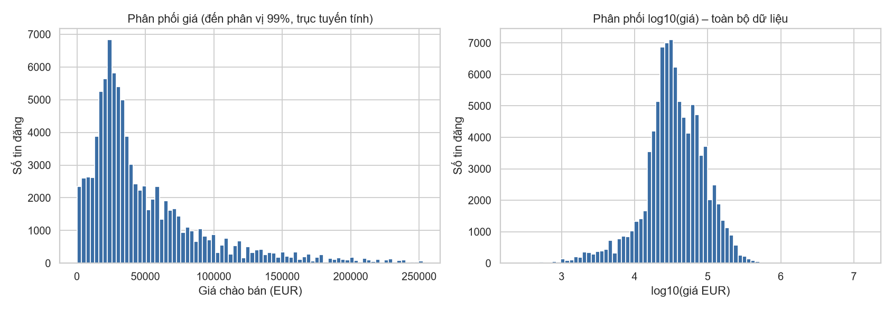
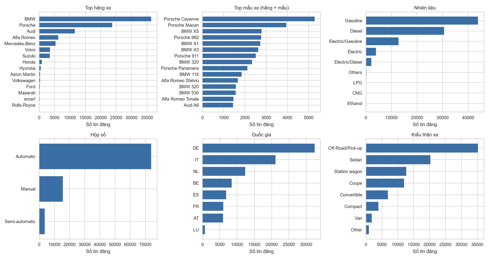
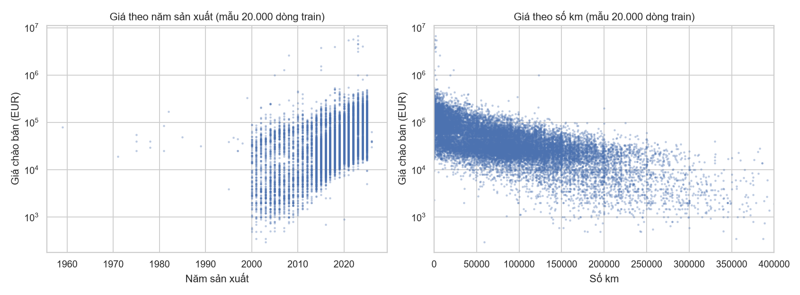
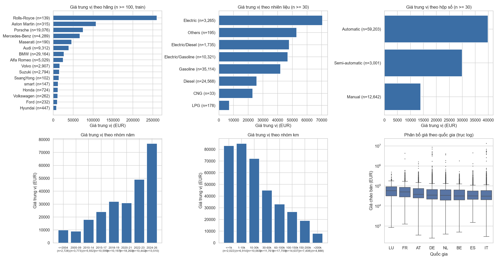
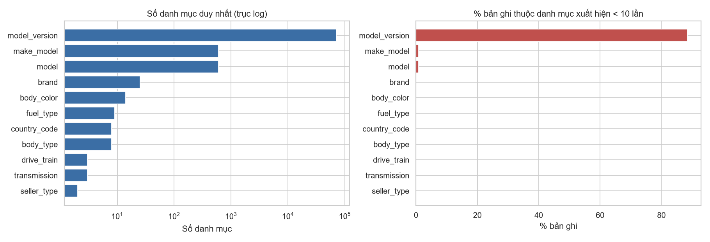

# Báo cáo Tuần 1 – Dự đoán giá ô tô cũ trên dữ liệu có nhiều thuộc tính phân loại

_Mọi số liệu trong báo cáo được sinh từ dataset thật bởi `python main.py` (xem `reports/stats.json`)._

## Chương 1. Tổng quan

**Đề tài.** Dự đoán giá chào bán (EUR) của ô tô cũ từ các thuộc tính mô tả xe, tập trung đánh giá ảnh hưởng của *mã hóa biến phân loại* (One-hot, Ordinal, Target, Frequency) và *chuẩn hóa dữ liệu* (No scaling, Standard, MinMax, Robust, log) lên bốn mô hình hồi quy (KNN, Ridge, SVR, Random Forest). Tuần 1 chỉ chuẩn bị dữ liệu: làm sạch, EDA, phân tích cardinality, schema, chia train/test an toàn – không có encoding/scaling/mô hình.

**Bài toán:** học có giám sát, hồi quy, dữ liệu bảng. X = thuộc tính xe lúc đăng bán; y = `price` (EUR), là *giá chào bán* chứ không phải giá giao dịch. **Vai trò biến phân loại:** hầu hết thuộc tính mô tả xe (hãng, mẫu, phiên bản, nhiên liệu…) là phân loại, một số có hàng nghìn giá trị → cách mã hóa quyết định số chiều, mức rò rỉ và chất lượng mô hình.

Định hướng dài hạn: pipeline dùng *common schema* và *adapter* để sau này thay AutoScout24 bằng dữ liệu Việt Nam (chỉ cần viết `vietnam_adapter.py`).

## Chương 2. Dataset

- **Nguồn:** AutoScout24 Car Listings Dataset (snapshot 08/11/2025), Zenodo record 17643343, DOI 10.5281/zenodo.17643343, v1.0.0, công bố 18/11/2025, giấy phép MIT theo metadata Zenodo. Tệp `autoscout24_dataset_20251108.csv`, 548.610.318 byte, MD5 `b23a122cc51baf7de39f449193ff0d28` (đã tính lại trên file và khớp với giá trị công bố).
- **Quy mô thực tế:** **118,382 dòng × 75 cột** (Zenodo ghi "~120K"). RAM pandas ≈ 586 MB.
- **Cột rỗng 100%:** fuel_cons_city_l100_km, fuel_cons_highway_l100_km, has_warranty, warranty. Cột thiếu > 50%: 17 cột (gồm `production_year`, `vin`, `price_net`).
- **Giới hạn:** (1) chỉ 25 hãng, chủ yếu BMW/Porsche/Mercedes/Audi – thiên về xe cao cấp, không đại diện thị trường phổ thông; (2) không có thời điểm đăng tin; (3) giá chào bán; (4) 8 thị trường châu Âu; (5) một số cờ trạng thái xe không nhất quán (Chương 4); (6) dữ liệu gốc do bên thứ ba tổng hợp, có lỗi nhập liệu (giá, công suất, số ghế).

## Chương 3. Khám phá dữ liệu

**Target (sau cleaning, 94,266 xe):** trung vị 34,490 EUR, trung bình 54,283, p5 6,300, p95 154,495, p99.9 520,998, tối đa 13,500,000. Độ lệch (skew) = **47.0** trên thang EUR nhưng chỉ **-0.54** sau log1p → phân phối lệch phải rất mạnh, log-transform là ứng viên hợp lý cho thí nghiệm tuần 2 (cần kiểm chứng, đặc biệt khi đánh giá RMSE trên thang gốc). Xe cực đắt (Bugatti…) là hợp lệ và được giữ lại; sẽ ảnh hưởng mạnh RMSE.

**Thiếu/trùng:** raw có 0 dòng trùng toàn bộ, 0 `id` trùng, nhưng 2,644 dòng có VIN lặp. Sau cleaning còn thiếu: drive_train 24.2%, body_color 12.1%, transmission 0.81%.

**Hãng & mẫu xe:** 25 hãng (không có biến thể chính tả trùng nhau theo casefold), 602 mẫu, 603 cặp hãng-mẫu. Hãng lớn nhất: BMW (38.68%).

**Thuộc tính số (tương quan Spearman với giá, train):** power_kw +0.80, mileage_km -0.64, production_year +0.53, engine_cc +0.58, nr_seats -0.31. Đây chỉ là mô tả đơn biến; không dùng để kết luận biến nào hữu ích hay loại biến.

Lưu ý khi đọc: giá trung vị theo nhóm đều kèm số quan sát n; nhóm n nhỏ (vd. LPG, CNG, Luxembourg) không đủ cơ sở kết luận. Giá theo quốc gia bị nhiễu bởi cơ cấu hãng/xe khác nhau giữa các nước.

## Chương 4. Tiền xử lý

**Phễu lọc (chi tiết trong `cleaning_log.md`):**

| step | rows_before | rows_after | rows_removed |
|---|---|---|---|
| raw | 118,382 | 118,382 | 0 |
| used_only | 118,382 | 95,684 | 22,698 |
| offer_type | 95,684 | 95,681 | 3 |
| vehicle_type | 95,681 | 95,600 | 81 |
| commercial_body_type | 95,600 | 95,407 | 193 |
| currency | 95,407 | 95,407 | 0 |
| price_not_null | 95,407 | 95,407 | 0 |
| price_positive | 95,407 | 95,407 | 0 |
| price_min | 95,407 | 95,399 | 8 |
| content_duplicates | 95,399 | 94,266 | 1,133 |

**Quy tắc xe cũ:** `is_used = True` và `is_new = False`, `offer_type = U`. 14,744 tin không phải xe mới/đăng ký trước nhưng không có cờ `is_used` bị loại vì không xác nhận được (trường hợp cần xem xét).

**Tiền tệ:** toàn bộ EUR (kiểm tra bằng code), không chuyển đổi. **Phạm vi thị trường:** 

| country_code | n | share_pct | median_price | p10 | p90 |
|---|---|---|---|---|---|
| DE | 32,516 | 34.49 | 34,970 | 11,950 | 109,900 |
| IT | 21,181 | 22.47 | 30,900 | 10,600 | 98,911 |
| NL | 12,381 | 13.13 | 33,945 | 6,250 | 119,911 |
| BE | 8,525 | 9.04 | 32,450 | 12,966 | 107,900 |
| ES | 6,887 | 7.31 | 32,228 | 15,990 | 95,200 |
| FR | 6,057 | 6.43 | 49,990 | 17,990 | 145,870 |
| AT | 5,974 | 6.34 | 38,500 | 16,262 | 116,975 |
| LU | 733 | 0.78 | 59,890 | 19,000 | 154,998 |
|  | 12 | 0.01 | 49,995 | 29,540 | 169,955 |

→ **Chọn phương án A (tất cả thị trường hợp lệ, giữ `country_code` làm feature)** vì: mẫu lớn hơn (94,266 vs. 32,516 nếu chỉ lấy Đức), `country_code` thêm một biến phân loại (cardinality thấp) cho nghiên cứu encoding, và không thị trường nào áp đảo hoàn toàn (Đức 34.5%). Nhược điểm: khác biệt thuế/chính sách giữa nước, Luxembourg (733 tin) và 12 tin thiếu quốc gia là nhóm nhỏ. Không loại/gộp quốc gia nào. Phương án B (chỉ Đức) có thể chạy như thí nghiệm phụ bằng cách lọc `country_code == 'DE'`.

**Feature engineering:** `vehicle_age = 2025 − production_year` (năm snapshot); `make_model`. Năm sản xuất (nguồn): 82,793 từ ngày đăng ký, 11,453 từ production_year gốc, 20 thiếu. **Feature selection & leakage:** xem `feature_selection.md` và `leakage_risks.md`; `price_net`, `price_vat_rate`, `price_tax_deductible`, `price_negotiable`, VIN, id, mô tả, tên người bán bị loại khỏi feature chính.

## Chương 5. Phân tích cardinality

| column | n_unique | level | pct_missing | n_cat_count_eq1 | n_cat_count_lt5 | n_cat_count_lt10 | pct_rows_in_cats_lt10 |
|---|---|---|---|---|---|---|---|
| model_version | 71,015 | high (>50) | 0.77 | 63,854 | 69,713 | 70,560 | 88.44 |
| make_model | 603 | high (>50) | 0.75 | 92 | 181 | 249 | 0.83 |
| model | 602 | high (>50) | 0.75 | 91 | 180 | 248 | 0.83 |
| brand | 25 | medium (11-50) | 0 | 0 | 0 | 1 | 0.01 |
| body_color | 14 | medium (11-50) | 12.05 | 0 | 0 | 0 | 0 |
| fuel_type | 9 | low (<=10) | 0.06 | 0 | 0 | 1 | 0.01 |
| body_type | 8 | low (<=10) | 0 | 0 | 0 | 0 | 0 |
| country_code | 8 | low (<=10) | 0.01 | 0 | 0 | 0 | 0 |
| transmission | 3 | low (<=10) | 0.81 | 0 | 0 | 0 | 0 |
| drive_train | 3 | low (<=10) | 24.18 | 0 | 0 | 0 | 0 |
| seller_type | 2 | low (<=10) | 0.01 | 0 | 0 | 0 | 0 |

**Phát hiện chính:** `model_version` có 71,015 danh mục, 89.92% chỉ xuất hiện một lần, 89.13% bản ghi thuộc danh mục < 10 lần, 647 nhóm khác nhau chỉ ở chữ hoa/thường. `model`/`make_model` có ~600 danh mục (≈ 0.832% bản ghi ở danh mục hiếm < 10). Các biến còn lại có ≤ 25 danh mục. Dự kiến: One-hot với model_version tạo ~71 nghìn cột; Ordinal tạo thứ tự giả; Target Encoding rủi ro rò rỉ nặng ở danh mục hiếm; Frequency Encoding gọn nhưng mất thông tin. Đây là *giả thuyết*, kiểm chứng ở tuần 2–3. Chi tiết: `feature_selection.md`.

## Chương 6. Chuẩn bị cho Machine Learning

**Common schema** (`src/adapters/schema.py`) + `autoscout24_adapter.py` (make→brand, fuel_category→fuel_type, cylinders_volume_cc→engine_cc, price_currency→currency, id→listing_id). **X và y:** y = `price`; X gồm 11 biến phân loại và 6 biến số (`select_xy` chặn target lọt vào X).

**Chia train/test:** không có cột thời gian → không chia theo thời gian. Nhưng cùng một xe có nhiều tin (VIN/dấu vân tay) → dùng **GroupShuffleSplit** (test 20%, seed 42). Kết quả: train 75,457 / test 18,809 (19.95% test), 91,263 nhóm, 1,866 nhóm nhiều tin (4,869 tin), giao nhóm train∩test = 0. Random split thường sẽ để 860 dòng test có tin cùng nhóm trong train. Ưu: không rò rỉ giữa các tin cùng xe; nhược: nhóm bắt được chưa đầy đủ (66% tin không VIN), tỷ lệ 80/20 chỉ xấp xỉ.

**Rò rỉ:** không imputer/scaler/encoder nào được fit trong tuần 1 (có unit test kiểm tra); bảng quan hệ feature–giá tính trên train. Tỷ lệ dòng test có danh mục chưa thấy ở train: model 0.13%, model_version 72.18%, make_model 0.13%.

**Thiết kế Pipeline tuần 2:** `ColumnTransformer(imputer → encoder → scaler)` + mô hình, bọc trong `Pipeline`; đánh giá bằng GroupKFold trên train, test chỉ dùng một lần ở cuối; target/frequency encoding fit trong từng fold; báo cáo RMSE, MAE, R², số chiều, thời gian huấn luyện.

## Chương 7. Kết quả đạt được

**Tệp chính:** `src/` (config, download_dataset, load_data, profiling, data_validation, cleaning, feature_engineering, split_data, eda, reporting, adapters/), `tests/`, `main.py`, `notebooks/01_exploratory_data_analysis.ipynb`, `reports/*.md`, `reports/figures/`, `reports/tables/`, `data/interim/*.parquet`, `data/processed/{train,test}.parquet`, `split_manifest.csv`, `split_metadata.json`.

**Kiểm thử:** 25 passed in 2.81s (python -m pytest -v, 4 tệp test, 25 test)

**Vấn đề chưa giải quyết:**

- 14,744 tin trạng thái xe không xác định bị loại – có thể gây thiên lệch.
- 6 tin giá nghi lỗi chỉ gắn cờ (`price_review_list.csv`), chưa loại.
- Tin trùng không VIN chỉ được phát hiện gần đúng.
- Dữ liệu thiên về xe cao cấp châu Âu; chưa đại diện cho thị trường Việt Nam.
- Chưa kiểm tra tính nhất quán giữa `model_version` và các cột kỹ thuật.

**Kế hoạch tuần 2:** xây Pipeline encoding × scaling; baseline; xử lý thiếu trong pipeline; thí nghiệm log-target; gom danh mục hiếm học trên train; đánh giá bằng GroupKFold.

## Phụ lục – Khả năng tái lập

Phiên bản: Python 3.13.11, pandas 3.1.0, numpy 2.5.4, scikit-learn 1.9.1. Seed 42, test_size 0.2, snapshot 2025-11-08. Chạy lại: xem README.
