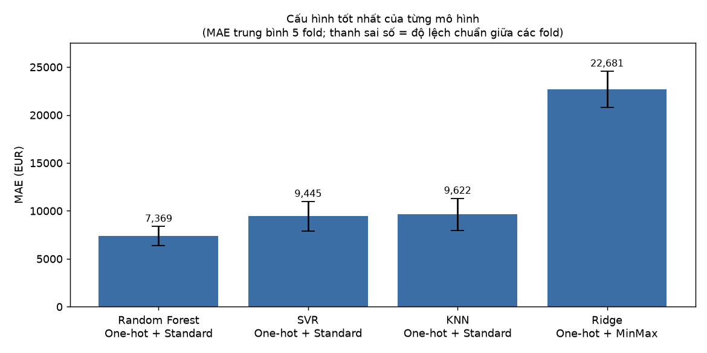
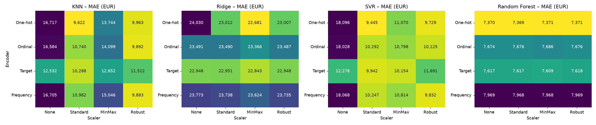
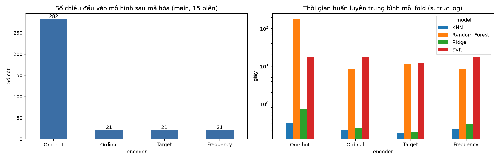
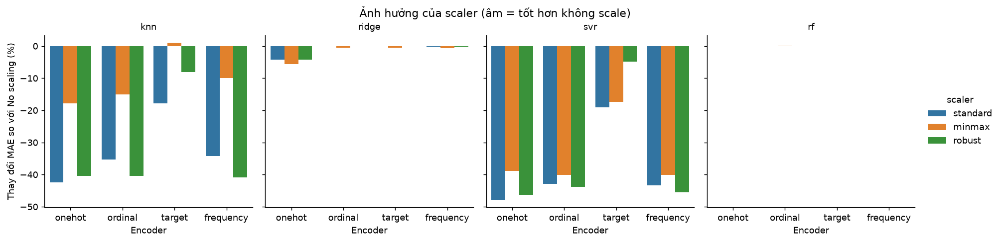
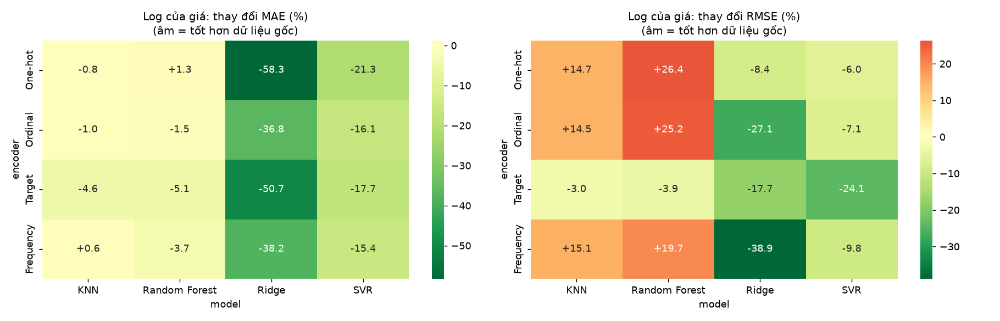
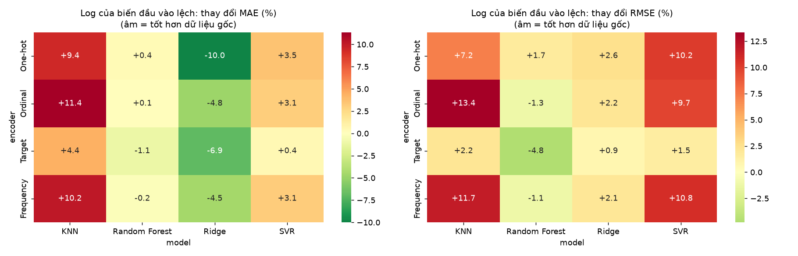
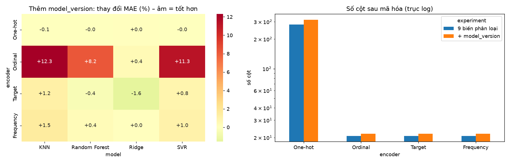

# Báo cáo Tuần 2 – Encoding × Scaling × Mô hình hồi quy

_Mọi số liệu được tính từ `data/processed/train.parquet` và lưu ở `reports/tables/week2_*.csv`. Báo cáo sinh bằng `python -m src.reporting_week2`._

## 1. Mục tiêu và phạm vi

Tuần 2 xây dựng và chạy bộ thí nghiệm so sánh bốn cách mã hóa biến phân loại, bốn cách chuẩn hóa (cùng hai thí nghiệm log transformation) và bốn mô hình hồi quy trên tập train đã chia ở tuần 1, rồi trả lời: cách mã hóa/chuẩn hóa nào ảnh hưởng đến sai số, số chiều và thời gian huấn luyện. **Không** dùng tập test, **không** tinh chỉnh siêu tham số (để tuần 3).

## 2. Thiết kế thí nghiệm

**Câu hỏi nghiên cứu:** mã hóa biến phân loại và chuẩn hóa dữ liệu ảnh hưởng thế nào đến sai số dự đoán giá, số chiều và thời gian huấn luyện của bốn mô hình hồi quy.

| Thành phần | Các mức | Ghi chú |
|---|---|---|
| Encoding | One-hot, Ordinal, Target, Frequency | One-hot: gom danh mục xuất hiện < 10 lần trong fold train vào một cột "infrequent". Ordinal: mã theo thứ tự chữ cái, danh mục lạ = −1. Target: `TargetEncoder` của sklearn (cross-fitting 5 fold + làm mượt). Frequency: tự cài đặt (`src/encoders.py`), danh mục lạ = 0 |
| Scaling | None, Standard, MinMax, Robust | Áp dụng cho biến số và cho các cột đã mã hóa số (Ordinal/Target/Frequency). Các cột One-hot (0/1) không scale |
| Mô hình | KNN, Ridge, SVR, Random Forest | Siêu tham số **cố định, chưa tinh chỉnh**: KNN k=10 (trọng số theo khoảng cách); Ridge α=1; SVR RBF C=10, ε=0,1 (target được chuẩn hóa bên trong SVR vì ε và C tính theo đơn vị của y); Random Forest 100 cây, `min_samples_leaf=2` |
| Biến đầu vào | 9 biến phân loại + 6 biến số | `brand`, `model`, `fuel_type`, `transmission`, `body_type`, `country_code`, `seller_type`, `drive_train`, `body_color`; `production_year`, `vehicle_age`, `mileage_km`, `power_kw`, `engine_cc`, `nr_seats`. Không có `model_version` (xem thí nghiệm riêng) |
| Thiếu dữ liệu | Trung vị (kèm cờ báo thiếu) cho biến số; nhãn `missing` cho biến phân loại | Học trong từng fold train |

**Năm nhóm thí nghiệm** (tổng 112 cấu hình × 5 fold = 560 lần huấn luyện trên tập con, cộng 60 lần xác nhận trên toàn train):

1. **main:** 4 encoder × 4 scaler × 4 mô hình = 64 cấu hình, target là giá gốc (EUR).
2. **log_target:** biến đổi log (`log1p`) áp dụng cho **giá** (target), 4 encoder × 4 mô hình, scaler Standard; dự đoán được đổi ngược bằng `expm1` nên mọi chỉ số vẫn tính theo EUR.
3. **log_features:** `log1p` áp dụng cho ba **biến đầu vào** lệch phải (`mileage_km`, `power_kw`, `engine_cc`) trước khi điền thiếu và scale, 4 encoder × 4 mô hình, scaler Standard, giá gốc. Hai thí nghiệm 2 và 3 cùng làm nên thí nghiệm riêng về log transformation.
4. **model_version:** thêm `model_version` (71,015 danh mục) vào 9 biến phân loại, 4 encoder × 4 mô hình, scaler Standard.
5. **full_train_confirm:** chạy lại 4 encoder trên **toàn bộ train** (75,457 dòng) cho KNN, Ridge, Random Forest để kiểm tra kết luận có giữ nguyên khi tăng dữ liệu không (SVR bỏ qua vì độ phức tạp O(n²)).

**Đánh giá:** GroupKFold 5 fold trên tập train, nhóm = `group_id` (cùng một xe không nằm ở cả hai phía của fold). Lưới chính chạy trên **tập con 20,001 dòng** của train (lấy theo nhóm xe nguyên vẹn, seed 42) để SVR chạy được trong thời gian hợp lý và để mọi mô hình so sánh trên cùng dữ liệu. **Tập test không được đọc ở bất kỳ bước nào của tuần 2** (có unit test kiểm tra). Mỗi lần chạy lưu "chữ ký" (dữ liệu, số fold, seed, siêu tham số, phiên bản sklearn) và từ chối ghi tiếp vào kết quả cũ nếu chữ ký khác, để không trộn kết quả khác điều kiện.

**Chỉ số:** MAE (chỉ số chính, vì giá lệch rất mạnh), RMSE, R², MedAPE (trung vị sai số phần trăm), số chiều đầu vào mô hình, thời gian huấn luyện. RMSE và R² bị chi phối bởi một số ít xe cực đắt nên dao động mạnh giữa các fold; vì vậy kết luận dựa trên MAE/MedAPE và trên **so sánh cặp theo fold** (đếm số fold trong 5 fold mà phương pháp A tốt hơn B). 5 fold chưa đủ cho kiểm định thống kê chính thức nên báo cáo không đưa p-value. Thời gian huấn luyện được đo khi nhiều tiến trình chạy song song nên chỉ dùng để so sánh tương đối (con số tuyệt đối thay đổi theo tải máy).

**Chống rò rỉ:** imputer, scaler, encoder (kể cả Target Encoding) là các bước trong `Pipeline`, chỉ `fit` trên phần train của từng fold. Ghi chú: cross-fitting bên trong `TargetEncoder` chia ngẫu nhiên chứ không theo nhóm xe, nên các tin trùng xe trong cùng fold train có thể khiến mã hóa của train hơi lạc quan; ảnh hưởng này chỉ nằm trong phần train, không chạm vào fold đánh giá.

## 3. Kết quả chính (giá gốc, 64 cấu hình)

**Cấu hình tốt nhất của từng mô hình (theo MAE trung bình 5 fold):**

| model | encoder | scaler | MAE | MAE std (fold) | RMSE | R² | MedAPE % | số cột | fit (s) |
|---|---|---|---|---|---|---|---|---|---|
| Random Forest | One-hot | Standard | 7,369.14 | 1,000.74 | 44,435.56 | 0.76 | 8.84 | 282 | 178.41 |
| SVR | One-hot | Standard | 9,445.45 | 1,525.06 | 61,838.15 | 0.59 | 13.39 | 282 | 17.53 |
| KNN | One-hot | Standard | 9,621.97 | 1,675.18 | 59,461.10 | 0.60 | 11.63 | 282 | 0.31 |
| Ridge | One-hot | MinMax | 22,681.17 | 1,880.95 | 79,087.72 | 0.31 | 35.63 | 282 | 0.55 |

**Toàn bộ 4 encoder với scaler Standard** (cùng điều kiện cho cả bốn mô hình):

| model | encoder | MAE | RMSE | R² | MedAPE % | số cột | fit (s) |
|---|---|---|---|---|---|---|---|
| KNN | One-hot | 9,621.97 | 59,461.10 | 0.60 | 11.63 | 282 | 0.31 |
| KNN | Target | 10,287.82 | 65,659.04 | 0.56 | 12.56 | 21 | 0.17 |
| KNN | Ordinal | 10,739.66 | 60,008.47 | 0.59 | 13.47 | 21 | 0.20 |
| KNN | Frequency | 10,981.70 | 59,671.62 | 0.59 | 13.90 | 21 | 0.22 |
| Random Forest | One-hot | 7,369.14 | 44,435.56 | 0.76 | 8.84 | 282 | 178.41 |
| Random Forest | Target | 7,617.44 | 49,789.23 | 0.72 | 9.13 | 21 | 11.69 |
| Random Forest | Ordinal | 7,675.92 | 46,867.74 | 0.74 | 8.97 | 21 | 8.61 |
| Random Forest | Frequency | 7,968.42 | 47,074.32 | 0.73 | 9.19 | 21 | 8.51 |
| Ridge | Target | 22,950.76 | 73,946.26 | 0.41 | 41.66 | 21 | 0.18 |
| Ridge | One-hot | 23,011.71 | 79,142.07 | 0.30 | 36.23 | 282 | 0.73 |
| Ridge | Ordinal | 23,489.51 | 79,269.94 | 0.34 | 40.47 | 21 | 0.23 |
| Ridge | Frequency | 23,737.61 | 79,107.60 | 0.34 | 42.28 | 21 | 0.29 |
| SVR | One-hot | 9,445.45 | 61,838.15 | 0.59 | 13.39 | 282 | 17.53 |
| SVR | Target | 9,941.78 | 70,912.45 | 0.49 | 13.16 | 21 | 11.88 |
| SVR | Frequency | 10,246.54 | 63,129.09 | 0.57 | 14.24 | 21 | 17.24 |
| SVR | Ordinal | 10,292.36 | 63,841.38 | 0.57 | 14.04 | 21 | 17.25 |

Các heatmap tương ứng cho MedAPE, RMSE và R²: `figures/week2_heatmap_medape.png`, `week2_heatmap_rmse.png`, `week2_heatmap_r2.png`. Bảng đầy đủ 64 cấu hình: `tables/week2_main_grid_ranked.csv`.

## 4. Ảnh hưởng của encoding

**So sánh cặp theo fold với One-hot** (scaler Standard; Δ > 0 nghĩa là encoder đó **tệ hơn** One-hot; cột cuối đếm số fold mà encoder đó tốt hơn One-hot):

| model | encoder | ΔMAE so với One-hot (EUR) | Δ% | số fold tốt hơn One-hot |
|---|---|---|---|---|
| KNN | Frequency | 1,359.73 | 14.13 | 0 / 5 |
| KNN | Ordinal | 1,117.70 | 11.62 | 0 / 5 |
| KNN | Target | 665.85 | 6.92 | 0 / 5 |
| Random Forest | Frequency | 599.28 | 8.13 | 0 / 5 |
| Random Forest | Ordinal | 306.78 | 4.16 | 0 / 5 |
| Random Forest | Target | 248.30 | 3.37 | 1 / 5 |
| Ridge | Frequency | 725.90 | 3.15 | 2 / 5 |
| Ridge | Ordinal | 477.79 | 2.08 | 2 / 5 |
| Ridge | Target | -60.95 | -0.26 | 2 / 5 |
| SVR | Frequency | 801.08 | 8.48 | 0 / 5 |
| SVR | Ordinal | 846.90 | 8.97 | 0 / 5 |
| SVR | Target | 496.33 | 5.25 | 0 / 5 |

**Số chiều và thời gian:** One-hot tạo 282 cột trên tập con (400 cột trên toàn train), ba encoder còn lại chỉ 21 cột (9 biến phân loại + 6 biến số + các cột cờ báo thiếu của biến số). Thời gian huấn luyện của Random Forest tăng mạnh với One-hot (ma trận thưa nhiều cột) – xem biểu đồ.

## 5. Ảnh hưởng của scaling

Mỗi dòng gộp 4 encoder × 5 fold = 20 trường hợp so sánh cặp với No scaling.

| model | scaler | Δ MAE trung bình so với No scaling (%) | số trường hợp tốt hơn No scaling (encoder × fold) |
|---|---|---|---|
| KNN | MinMax | -11.19 | 18 / 20 |
| KNN | Robust | -34.04 | 20 / 20 |
| KNN | Standard | -33.43 | 20 / 20 |
| Random Forest | MinMax | 0.01 | 12 / 20 |
| Random Forest | Robust | 0.01 | 9 / 20 |
| Random Forest | Standard | 0 | 9 / 20 |
| Ridge | MinMax | -1.83 | 15 / 20 |
| Ridge | Robust | -1.13 | 15 / 20 |
| Ridge | Standard | -1.12 | 14 / 20 |
| SVR | MinMax | -35.55 | 20 / 20 |
| SVR | Robust | -37.75 | 18 / 20 |
| SVR | Standard | -39.93 | 20 / 20 |

## 6. Log transformation, phần 1: log của giá (target)

Scaler Standard cho cả hai phía; Δ% < 0 nghĩa là log giá **tốt hơn** giá gốc.

**MAE (EUR):**

| model | encoder | giá gốc | log giá | Δ% | số fold tốt hơn |
|---|---|---|---|---|---|
| KNN | Frequency | 10,981.70 | 11,044.77 | 0.57 | 3 / 5 |
| KNN | One-hot | 9,621.97 | 9,548.67 | -0.76 | 3 / 5 |
| KNN | Ordinal | 10,739.66 | 10,631.67 | -1.01 | 3 / 5 |
| KNN | Target | 10,287.82 | 9,818.46 | -4.56 | 5 / 5 |
| Random Forest | Frequency | 7,968.42 | 7,676.44 | -3.66 | 4 / 5 |
| Random Forest | One-hot | 7,369.14 | 7,462.88 | 1.27 | 3 / 5 |
| Random Forest | Ordinal | 7,675.92 | 7,563.20 | -1.47 | 4 / 5 |
| Random Forest | Target | 7,617.44 | 7,226.39 | -5.13 | 5 / 5 |
| Ridge | Frequency | 23,737.61 | 14,658.78 | -38.25 | 5 / 5 |
| Ridge | One-hot | 23,011.71 | 9,590.04 | -58.33 | 5 / 5 |
| Ridge | Ordinal | 23,489.51 | 14,855.84 | -36.76 | 5 / 5 |
| Ridge | Target | 22,950.76 | 11,303.89 | -50.75 | 5 / 5 |
| SVR | Frequency | 10,246.54 | 8,667.01 | -15.42 | 5 / 5 |
| SVR | One-hot | 9,445.45 | 7,429 | -21.35 | 5 / 5 |
| SVR | Ordinal | 10,292.36 | 8,636.74 | -16.09 | 5 / 5 |
| SVR | Target | 9,941.78 | 8,177.17 | -17.75 | 5 / 5 |

**RMSE (EUR):**

| model | encoder | giá gốc | log giá | Δ% | số fold tốt hơn |
|---|---|---|---|---|---|
| KNN | Frequency | 59,671.62 | 68,658.20 | 15.06 | 0 / 5 |
| KNN | One-hot | 59,461.10 | 68,179.03 | 14.66 | 1 / 5 |
| KNN | Ordinal | 60,008.47 | 68,721.89 | 14.52 | 1 / 5 |
| KNN | Target | 65,659.04 | 63,677.10 | -3.02 | 3 / 5 |
| Random Forest | Frequency | 47,074.32 | 56,343.05 | 19.69 | 2 / 5 |
| Random Forest | One-hot | 44,435.56 | 56,172.93 | 26.41 | 2 / 5 |
| Random Forest | Ordinal | 46,867.74 | 58,661.96 | 25.16 | 2 / 5 |
| Random Forest | Target | 49,789.23 | 47,864.95 | -3.86 | 3 / 5 |
| Ridge | Frequency | 79,107.60 | 48,357.21 | -38.87 | 5 / 5 |
| Ridge | One-hot | 79,142.07 | 72,467.30 | -8.43 | 3 / 5 |
| Ridge | Ordinal | 79,269.94 | 57,807.96 | -27.07 | 5 / 5 |
| Ridge | Target | 73,946.26 | 60,889.57 | -17.66 | 4 / 5 |
| SVR | Frequency | 63,129.09 | 56,955.89 | -9.78 | 3 / 5 |
| SVR | One-hot | 61,838.15 | 58,136.39 | -5.99 | 2 / 5 |
| SVR | Ordinal | 63,841.38 | 59,296.53 | -7.12 | 3 / 5 |
| SVR | Target | 70,912.45 | 53,821.89 | -24.10 | 3 / 5 |

## 7. Log transformation, phần 2: log của biến đầu vào lệch

`log1p` áp dụng cho `mileage_km`, `power_kw`, `engine_cc` (giá gốc, scaler Standard cho cả hai phía). Δ% < 0 là log đầu vào **tốt hơn**.

**MAE (EUR):**

| model | encoder | không log | log đầu vào | Δ% | số fold tốt hơn |
|---|---|---|---|---|---|
| KNN | Frequency | 10,981.70 | 12,096.40 | 10.15 | 0 / 5 |
| KNN | One-hot | 9,621.97 | 10,529.66 | 9.43 | 0 / 5 |
| KNN | Ordinal | 10,739.66 | 11,960.70 | 11.37 | 0 / 5 |
| KNN | Target | 10,287.82 | 10,740.40 | 4.40 | 0 / 5 |
| Random Forest | Frequency | 7,968.42 | 7,951.19 | -0.22 | 4 / 5 |
| Random Forest | One-hot | 7,369.14 | 7,396.71 | 0.37 | 3 / 5 |
| Random Forest | Ordinal | 7,675.92 | 7,684.99 | 0.12 | 2 / 5 |
| Random Forest | Target | 7,617.44 | 7,531.19 | -1.13 | 5 / 5 |
| Ridge | Frequency | 23,737.61 | 22,666.88 | -4.51 | 4 / 5 |
| Ridge | One-hot | 23,011.71 | 20,708.57 | -10.01 | 5 / 5 |
| Ridge | Ordinal | 23,489.51 | 22,358.44 | -4.82 | 4 / 5 |
| Ridge | Target | 22,950.76 | 21,357.18 | -6.94 | 5 / 5 |
| SVR | Frequency | 10,246.54 | 10,564.93 | 3.11 | 0 / 5 |
| SVR | One-hot | 9,445.45 | 9,779.97 | 3.54 | 0 / 5 |
| SVR | Ordinal | 10,292.36 | 10,608.40 | 3.07 | 0 / 5 |
| SVR | Target | 9,941.78 | 9,986.15 | 0.45 | 1 / 5 |

**RMSE (EUR):**

| model | encoder | không log | log đầu vào | Δ% | số fold tốt hơn |
|---|---|---|---|---|---|
| KNN | Frequency | 59,671.62 | 66,659.07 | 11.71 | 1 / 5 |
| KNN | One-hot | 59,461.10 | 63,770.57 | 7.25 | 1 / 5 |
| KNN | Ordinal | 60,008.47 | 68,026.62 | 13.36 | 1 / 5 |
| KNN | Target | 65,659.04 | 67,103.53 | 2.20 | 2 / 5 |
| Random Forest | Frequency | 47,074.32 | 46,551.03 | -1.11 | 4 / 5 |
| Random Forest | One-hot | 44,435.56 | 45,198.56 | 1.72 | 3 / 5 |
| Random Forest | Ordinal | 46,867.74 | 46,281.73 | -1.25 | 4 / 5 |
| Random Forest | Target | 49,789.23 | 47,399.85 | -4.80 | 4 / 5 |
| Ridge | Frequency | 79,107.60 | 80,741.96 | 2.07 | 2 / 5 |
| Ridge | One-hot | 79,142.07 | 81,221.70 | 2.63 | 2 / 5 |
| Ridge | Ordinal | 79,269.94 | 80,979.24 | 2.16 | 2 / 5 |
| Ridge | Target | 73,946.26 | 74,585.33 | 0.86 | 2 / 5 |
| SVR | Frequency | 63,129.09 | 69,935.51 | 10.78 | 2 / 5 |
| SVR | One-hot | 61,838.15 | 68,169.43 | 10.24 | 2 / 5 |
| SVR | Ordinal | 63,841.38 | 70,019.99 | 9.68 | 2 / 5 |
| SVR | Target | 70,912.45 | 72,003.22 | 1.54 | 1 / 5 |

## 8. Thí nghiệm cardinality: thêm `model_version`

Scaler Standard, giá gốc. Δ% < 0 là có `model_version` tốt hơn.

| model | encoder | MAE không có model_version | MAE có model_version | Δ% | số fold tốt hơn |
|---|---|---|---|---|---|
| KNN | Frequency | 10,981.70 | 11,148.74 | 1.52 | 0 / 5 |
| KNN | One-hot | 9,621.97 | 9,613.65 | -0.09 | 3 / 5 |
| KNN | Ordinal | 10,739.66 | 12,062.91 | 12.32 | 0 / 5 |
| KNN | Target | 10,287.82 | 10,411.42 | 1.20 | 0 / 5 |
| Random Forest | Frequency | 7,968.42 | 7,996.98 | 0.36 | 1 / 5 |
| Random Forest | One-hot | 7,369.14 | 7,367.40 | -0.02 | 4 / 5 |
| Random Forest | Ordinal | 7,675.92 | 8,303.14 | 8.17 | 0 / 5 |
| Random Forest | Target | 7,617.44 | 7,584.58 | -0.43 | 4 / 5 |
| Ridge | Frequency | 23,737.61 | 23,739.93 | 0.01 | 0 / 5 |
| Ridge | One-hot | 23,011.71 | 23,018.58 | 0.03 | 2 / 5 |
| Ridge | Ordinal | 23,489.51 | 23,594.16 | 0.45 | 0 / 5 |
| Ridge | Target | 22,950.76 | 22,591.38 | -1.57 | 5 / 5 |
| SVR | Frequency | 10,246.54 | 10,353.29 | 1.04 | 0 / 5 |
| SVR | One-hot | 9,445.45 | 9,441.53 | -0.04 | 3 / 5 |
| SVR | Ordinal | 10,292.36 | 11,453.77 | 11.28 | 0 / 5 |
| SVR | Target | 9,941.78 | 10,025.55 | 0.84 | 1 / 5 |

Số cột sau mã hóa (One-hot): 282 → 314 khi thêm `model_version` (do gom danh mục < 10 lần vào cột "infrequent"). Các encoder còn lại: 21 → 22 cột.

## 9. Xác nhận trên toàn bộ train (75,457 dòng)

Mỗi mô hình dùng scaler tốt nhất của nó trên tập con 20k. Thứ hạng encoder (1 = MAE thấp nhất) giữ nguyên ở 7/12 dòng; encoder tốt nhất của từng mô hình trùng giữa 20k và 75k.

| model | encoder | scaler | MAE (20k) | MAE (75k) | hạng (20k) | hạng (75k) | RMSE (75k) | R² (75k) | fit (s) |
|---|---|---|---|---|---|---|---|---|---|
| KNN | One-hot | Standard | 9,621.97 | 8,079.90 | 1 | 1 | 55,364.71 | 0.78 | 1.05 |
| KNN | Ordinal | Standard | 10,739.66 | 8,988.05 | 3 | 2 | 59,331.13 | 0.75 | 0.70 |
| KNN | Target | Standard | 10,287.82 | 9,012.32 | 2 | 3 | 70,822.37 | 0.62 | 1.22 |
| KNN | Frequency | Standard | 10,981.70 | 9,182.16 | 4 | 4 | 60,241.38 | 0.74 | 1.35 |
| Random Forest | One-hot | Standard | 7,369.14 | 6,276.04 | 1 | 1 | 49,383.58 | 0.83 | 1,162.45 |
| Random Forest | Ordinal | Standard | 7,675.92 | 6,494.63 | 3 | 2 | 51,301.70 | 0.82 | 153.44 |
| Random Forest | Frequency | Standard | 7,968.42 | 6,631.28 | 4 | 3 | 48,671.17 | 0.84 | 85.98 |
| Random Forest | Target | Standard | 7,617.44 | 6,661.96 | 2 | 4 | 50,551.62 | 0.82 | 75.96 |
| Ridge | One-hot | MinMax | 22,681.17 | 15,740.86 | 1 | 1 | 66,248.59 | 0.70 | 1.91 |
| Ridge | Target | MinMax | 22,842.90 | 23,123.74 | 2 | 2 | 86,735.72 | 0.47 | 1.01 |
| Ridge | Ordinal | MinMax | 23,366.01 | 26,012.06 | 3 | 3 | 106,980.86 | 0.22 | 0.89 |
| Ridge | Frequency | MinMax | 23,623.73 | 26,428.22 | 4 | 4 | 106,497.74 | 0.23 | 1.37 |

## 10. Thảo luận và kiểm chứng giả thuyết đặt ra ở tuần 1

1. **"Log giá cải thiện mô hình tuyến tính"** → *được ủng hộ cho Ridge và SVR.* Với Ridge, log giá giảm MAE từ 37% đến 58% tùy encoder (5/5 fold). Nhưng với KNN và Random Forest, log giá làm **RMSE tệ hơn** +15% đến +26% (ngoại trừ Target Encoding) trong khi MAE đổi rất ít. Một giải thích hợp lý (chưa kiểm chứng riêng) là khi dự đoán trong không gian log rồi đổi ngược, các xe cực đắt bị dự đoán thấp hơn thực tế nên sai số ở đuôi giá tăng. Log giá không phải lựa chọn tốt hơn một cách tuyệt đối; hiệu quả phụ thuộc mô hình và chỉ số.
2. **"One-hot + Ridge tốt nhưng chiều lớn khi có model_version"** → *một phần: vế đầu đúng khi đủ dữ liệu, vế sau không xảy ra.* Trên tập con 20k với giá gốc, Ridge gần như không phân biệt được các encoder (chênh lệch tối đa 3.2%, mỗi encoder tốt hơn One-hot nhiều nhất 2/5 fold); trên toàn bộ train One-hot vượt rõ rệt (mục 9). Khi thêm `model_version`, One-hot chỉ tăng từ 282 lên 314 cột vì đã gom danh mục hiếm; MAE gần như không đổi (thay đổi tối đa 0.1% ở mọi mô hình). Điều này phù hợp với việc hầu hết giá trị `model_version` hiếm đến mức bị gom vào cột "infrequent" nên không đóng góp thông tin (giải thích hợp lý, chưa kiểm chứng riêng).
3. **"KNN/SVR nhạy với scaling"** → *được ủng hộ mạnh.* So với No scaling, Standard giảm MAE của KNN 33% và của SVR 40% (trung bình 4 encoder; tốt hơn ở 20/20 trường hợp mỗi mô hình). Một giải thích hợp lý (chưa kiểm chứng riêng) là khi không scale, `mileage_km` (hàng trăm nghìn) áp đảo khoảng cách của KNN và kernel của SVR.
4. **"Random Forest ít phụ thuộc scaling"** → *được ủng hộ.* Thay đổi MAE lớn nhất giữa các scaler chỉ 0.01% (cây quyết định chỉ so sánh ngưỡng nên bất biến với biến đổi đơn điệu). Đây cũng là kiểm tra tính đúng đắn của pipeline.
5. **"Target Encoding chỉ có lợi nếu fit trong fold và làm mượt"** → *không có bằng chứng Target Encoding vượt One-hot trong lưới chính (và cả trên toàn train, mục 9):* với KNN, Random Forest và SVR, One-hot tốt hơn Target ở hầu hết fold. Target Encoding chỉ nổi bật khi KNN/SVR **không scale** (giá trị mã hóa cùng đơn vị với giá nên tự có thang đo lớn nhưng hợp lý). Cấu hình MAE thấp nhất toàn bộ thí nghiệm là Random Forest + Target + Standard (nhóm `log_target`).
6. **Log của biến đầu vào lệch (mileage, power, engine)** → *kết quả trái chiều theo mô hình.* MAE trung bình thay đổi: Ridge -6.6%, Random Forest -0.2%, SVR +2.5%, KNN +8.8%. Ridge hưởng lợi (quan hệ gần tuyến tính hơn sau log), Random Forest gần như không đổi (cây bất biến với biến đổi đơn điệu; chênh lệch nhỏ chỉ do giá trị điền thiếu thay đổi), còn KNN và SVR tệ hơn: một giải thích hợp lý (chưa kiểm chứng riêng) là log làm thay đổi cấu trúc khoảng cách giữa các xe (xe km thấp bị tách xa nhau hơn xe km cao), trong khi các mô hình dựa trên khoảng cách đã khai thác tốt thang đo gốc sau Standard.

**Kết luận về encoding:** One-hot cho MAE thấp hơn Ordinal và Frequency ở KNN, Random Forest và SVR trên tập con 20k (ở cả ba mô hình, Ordinal và Frequency không tốt hơn One-hot ở bất kỳ fold nào), và trên toàn bộ train One-hot là encoder tốt nhất của cả KNN, Ridge và Random Forest. **Xác nhận trên toàn bộ train làm thay đổi kết luận về Ridge:** trên tập con 20k, Ridge gần như không phân biệt các encoder, nhưng trên 75k dòng One-hot đạt MAE 15,741 EUR so với 23,124 EUR của encoder tốt nhất còn lại (-32%). Một giải thích hợp lý (chưa kiểm chứng riêng) là với nhiều dữ liệu hơn, One-hot cho phép Ridge học hệ số riêng cho từng hãng/mẫu, còn Ordinal/Frequency/Target ép mỗi biến phân loại thành một số duy nhất nên mô hình tuyến tính không biểu diễn được. Với Random Forest, One-hot chỉ cải thiện MAE 3.4% so với encoder tốt nhất còn lại nhưng thời gian huấn luyện lớn hơn khoảng 11 lần (1,162 s so với ~105 s mỗi fold; chỉ so sánh tương đối). Cái giá của One-hot là số cột (282 trên 20k dòng, 400 trên toàn train, so với 21) và thời gian huấn luyện. Ordinal và Frequency cho kết quả kém hơn, phù hợp với việc thứ tự giả và việc mất định danh danh mục đều gây hại cho các biến có nhiều danh mục như `model`. Với `model_version`, Ordinal tệ hơn rõ rệt ở KNN, Random Forest và SVR (+8% đến +12% MAE; 0/5 fold tốt hơn).

**Kết luận về scaling:** ảnh hưởng của scaler lớn hơn nhiều so với ảnh hưởng của encoder đối với KNN và SVR: chênh lệch MAE giữa scaler tốt nhất và tệ nhất là 52% (KNN) và 66% (SVR), trong khi giữa encoder tốt nhất và tệ nhất chỉ 12% và 12% (trung bình trên các mức của yếu tố còn lại; bảng `tables/week2_effect_scaler.csv`, `week2_effect_encoder.csv`). Ảnh hưởng của scaler nhỏ với Ridge (1.9%) và gần bằng 0 với Random Forest (0.01%). Giữa Standard và Robust, khác biệt nhỏ hơn nhiều so với khác biệt giữa "có scale" và "không scale"; MinMax kém hơn hai scaler còn lại cho KNN và SVR, một giải thích hợp lý (chưa kiểm chứng riêng) là các biến có đuôi dài (mileage, power) bị nén bởi giá trị lớn nhất.

**Kết luận chung:** MAE thấp nhất toàn bộ là 7,226 EUR; chênh lệch với cấu hình tốt thứ hai (141 EUR) so với độ lệch chuẩn giữa các fold (1,367 EUR) cho thấy **không nên kết luận một cấu hình duy nhất là tốt nhất**; kết luận vững hơn là xếp hạng theo nhóm (giá gốc, siêu tham số cố định): Random Forest tốt nhất, SVR và KNN gần nhau ở giữa, Ridge kém nhất.

## 11. Giới hạn và rủi ro

- Siêu tham số chưa được tinh chỉnh (k=10, α=1, C=10…); Ridge kém một phần vì quan hệ giá–đặc trưng phi tuyến và đuôi giá rất dài, một phần vì chưa chọn α. Xếp hạng giữa các mô hình có thể thay đổi sau khi tinh chỉnh (tuần 3).
- Lưới chính chạy trên tập con 20.000 dòng; phần xác nhận trên toàn train bỏ qua SVR. **Kết quả xác nhận cho thấy kết luận từ tập con không luôn bền** (Ridge, mục 9): mọi kết luận về encoding của Ridge cần dựa trên kết quả toàn train, và kết luận về SVR chưa được xác nhận trên dữ liệu lớn.
- Dữ liệu giá lệch cực mạnh, vài xe cực đắt làm RMSE và R² dao động giữa các fold; kết luận chính dựa trên MAE, MedAPE và so sánh cặp theo fold, không dựa trên RMSE.
- 5 fold chưa đủ cho kiểm định thống kê chính thức; báo cáo đếm số fold thay vì p-value.
- Mới thử một cách gom danh mục hiếm cho One-hot (ngưỡng 10); chưa thử gom cho các encoder khác. Log của biến đầu vào chỉ thử với ba biến lệch phải và scaler Standard.
- Các "giải thích hợp lý" trong báo cáo là giả thuyết, chưa được kiểm chứng bằng thí nghiệm riêng.
- Thời gian huấn luyện đo khi nhiều tiến trình chạy song song, chỉ dùng so sánh tương đối.
- Dữ liệu thiên về xe cao cấp châu Âu: kết luận về encoding/scaling cần kiểm lại trên dữ liệu Việt Nam.
- Cross-fitting của Target Encoding không chia theo nhóm xe (chỉ ảnh hưởng phần train).
- Chạy lại cùng cấu hình có thể lệch cỡ 1 phần triệu ở KNN (thứ tự cộng số thực khi chạy song song), không ảnh hưởng kết luận.

## 12. Kế hoạch tuần 3

1. Tinh chỉnh siêu tham số bằng cross-validation lồng/GroupKFold trên train (k của KNN, α của Ridge, C/ε/γ của SVR, độ sâu/số cây của Random Forest).
2. Gom danh mục hiếm của `model_version` bằng thống kê học trên train; thử Target Encoding có làm mượt mạnh hơn.
3. Quyết định xử lý các xe giá cực cao (chỉ trên train).
4. Đánh giá cuối cùng **một lần** trên `test.parquet` với cấu hình đã chốt; phân tích phần dư theo hãng, quốc gia, khoảng giá.
5. Chạy lại phần xác nhận cho SVR trên dữ liệu lớn hơn (hoặc dùng xấp xỉ nhanh).

## Phụ lục A. Tự kiểm chứng các phát biểu

Các phát biểu định tính ở mục 10 được máy tính kiểm tra lại với các bảng số liệu mỗi lần sinh báo cáo (`verify_claims` trong `src/reporting_week2.py`).

| mã | phát biểu trong báo cáo | kiểm tra với bảng số liệu |
|---|---|---|
| C1 | Ordinal và Frequency không tốt hơn One-hot ở bất kỳ fold nào (KNN, Random Forest, SVR; scaler Standard) | ĐÚNG |
| C2 | Target Encoding tốt hơn One-hot nhiều nhất 1/5 fold (KNN, Random Forest, SVR) | ĐÚNG |
| C3 | Trên tập con, Ridge: chênh lệch giữa các encoder ≤ 5% và không encoder nào tốt hơn One-hot quá 2/5 fold | ĐÚNG |
| C4 | Scaler Standard tốt hơn No scaling ở 20/20 trường hợp của KNN và của SVR | ĐÚNG |
| C5 | Random Forest bất biến với scaler (thay đổi MAE < 0,1%) | ĐÚNG |
| C6 | Log giá làm giảm MAE của Ridge ở 5/5 fold với mọi encoder | ĐÚNG |
| C7 | Log giá làm RMSE tệ hơn ở KNN và Random Forest (trừ Target Encoding) | ĐÚNG |
| C8 | Thêm model_version làm Ordinal tệ hơn ở 0/5 fold tốt hơn (KNN, Random Forest, SVR) | ĐÚNG |
| C9 | Thêm model_version làm MAE của One-hot đổi ≤ 0,5% ở mọi mô hình | ĐÚNG |
| C10 | Khi không scale, Target Encoding có MAE thấp nhất trong 4 encoder ở KNN và SVR | ĐÚNG |
| C11 | Trên toàn bộ train, One-hot có MAE thấp nhất trong 4 encoder ở KNN, Ridge và Random Forest | ĐÚNG |
| C12 | Log của biến đầu vào: MAE của KNN và SVR tăng ở mọi encoder, Ridge giảm ở mọi encoder, Random Forest đổi < 1,5% | ĐÚNG |
| C13 | Chênh lệch MAE giữa cấu hình tốt nhất và tốt thứ hai nhỏ hơn độ lệch chuẩn giữa các fold của cấu hình tốt nhất | ĐÚNG |
| C14 | Với giá gốc, Random Forest có MAE thấp nhất và Ridge cao nhất trong 4 mô hình (cấu hình tốt nhất của mỗi mô hình) | ĐÚNG |
