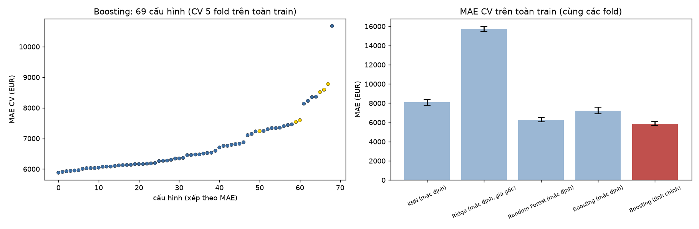
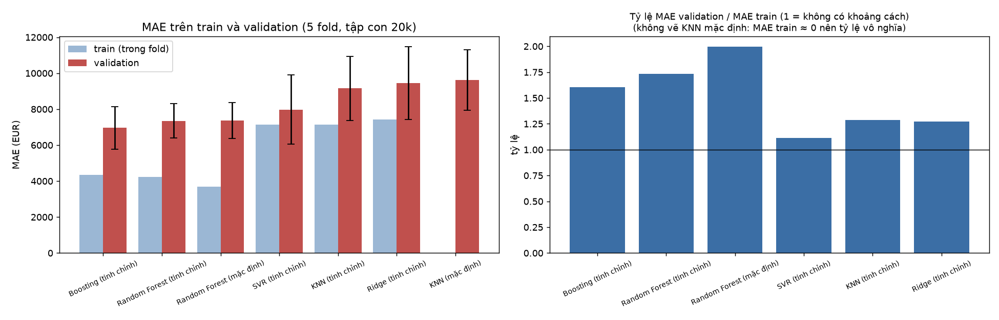
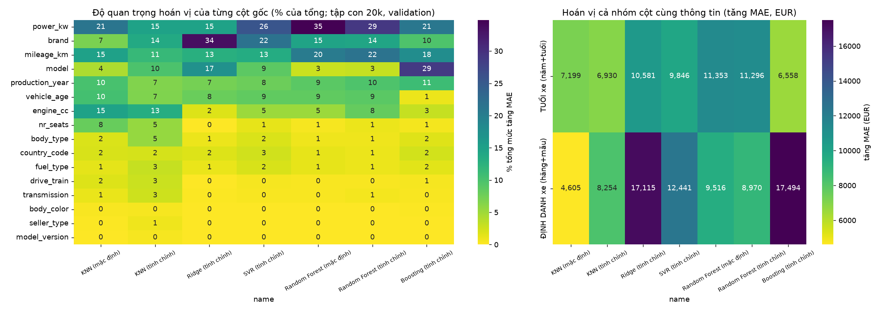
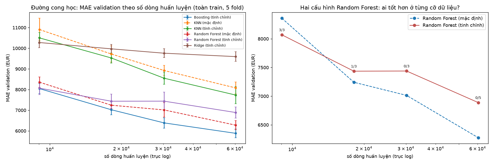

# Báo cáo bổ sung Tuần 3: boosting, chẩn đoán overfit, độ quan trọng đặc trưng, đường cong học

> **Lưu ý:** có phát biểu ở Phụ lục A không đúng với dữ liệu; đó là kết quả thật và được nêu trong báo cáo.

_Mọi số liệu tính từ `reports/tables/week3_*.csv` (chỉ dùng **tập train**). Sinh bằng `python -m src.reporting_week3_extra`._

## 1. Mục tiêu và nguyên tắc

Báo cáo chính tuần 3 còn bốn khoảng trống: chưa có mô hình boosting, chưa có chẩn đoán overfit, chưa biết biến nào quyết định giá, và giải thích vì sao Random Forest tinh chỉnh thua mặc định trên test mới chỉ là giả thuyết. Phần bổ sung này lấp các khoảng trống đó.

**Nguyên tắc quan trọng:** tập test đã được đánh giá **một lần** (`src/final_eval.py`) với các mô hình đã đóng băng. Boosting được thêm *sau* đó nên **không được đánh giá trên tập test** (xem lần hai là biến test thành tập chọn mô hình). Mọi so sánh ở đây là cross-validation trên train; số liệu test của báo cáo chính không thay đổi. Vì boosting rất nhanh, nó được tinh chỉnh trên **toàn bộ train** (75,457 dòng) chứ không phải tập con 20k như các mô hình khác.

## 2. Boosting (HistGradientBoosting) tinh chỉnh trên toàn train

**Mô hình:** `HistGradientBoostingRegressor` của scikit-learn, số vòng lặp cố định (không dùng tách validation bên trong), đầu vào qua cùng pipeline (điền thiếu → mã hóa → mô hình).
**Quy trình:** (1) chọn bộ mã hóa × log giá với tham số mặc định; (2) tìm kiếm ngẫu nhiên 60 bộ siêu tham số (learning_rate ∈ {0.02, 0.05, 0.1, 0.2}; max_iter ∈ {100, 200, 400, 800, 1200}; max_leaf_nodes ∈ {15, 31, 63, 127}; min_samples_leaf ∈ {5, 10, 20, 50, 100}; l2_regularization ∈ {0.0, 0.1, 1.0, 10.0}; max_depth ∈ {None, 8, 12}); (3) thử thêm `model_version` (Target Encoding, gom danh mục hiếm) và chỉ nhận nếu thắng ≥ 4/5 fold. Tất cả bằng GroupKFold 5 fold trên toàn train.

**Bước 1 – bộ mã hóa với tham số mặc định:**

| encoder | log giá | MAE CV | R² CV | MedAPE % |
|---|---|---|---|---|
| One-hot | không | 8,593.88 | 0.81 | 11.73 |
| Target | không | 8,516.04 | 0.79 | 11.21 |
| Ordinal | không | 8,779.64 | 0.78 | 11.66 |
| One-hot | có | 7,597.15 | 0.77 | 9.41 |
| Ordinal | có | 7,541.77 | 0.80 | 9.49 |
| Target | có | 7,240.18 | 0.78 | 9.08 |

**Cấu hình boosting được chọn:** target, log giá, `{"l2_regularization": 10.0, "learning_rate": 0.05, "max_depth": null, "max_iter": 800, "max_leaf_nodes": 127, "min_samples_leaf": 20}`, không dùng model_version (kiểm tra model_version: MAE 5,880 → ứng viên tốt nhất 5,880; không đủ điều kiện 4/5 fold).

**So sánh trên toàn train (cùng các fold; các mô hình khác ở tham số mặc định, từ xác nhận tuần 2):**

| mô hình | nguồn | MAE | MAE std (fold) | RMSE | R² | MedAPE % | fit (s) | boosting tinh chỉnh thắng (số fold) |
|---|---|---|---|---|---|---|---|---|
| KNN (mặc định) | tuần 2, mặc định, toàn train | 8,079.90 | 288.16 | 55,364.71 | 0.78 | 9.92 | 1.05 | 5 / 5 |
| Ridge (mặc định, giá gốc) | tuần 2, mặc định, toàn train | 15,740.86 | 262.23 | 66,248.59 | 0.70 | 24.42 | 1.91 | 5 / 5 |
| Random Forest (mặc định) | tuần 2, mặc định, toàn train | 6,276.04 | 216.10 | 49,383.58 | 0.83 | 7.61 | 1,162.45 | 5 / 5 |
| Boosting (mặc định) | tuần 3, mặc định, toàn train | 7,240.18 | 329.85 | 54,298.07 | 0.78 | 9.08 | 18.56 | 5 / 5 |
| Boosting (tinh chỉnh) | tuần 3, đã tinh chỉnh, toàn train | 5,880.39 | 211.92 | 47,302.20 | 0.83 | 7.42 | 183.39 |  |

**Lưu ý trung thực:** (a) boosting đã được tinh chỉnh còn các mô hình ở cột so sánh thì chưa (mặc định tuần 2), nên chênh lệch một phần phản ánh nỗ lực tinh chỉnh, không chỉ loại mô hình; (b) chọn tốt nhất trong 60 ứng viên làm MAE CV hơi lạc quan; (c) **chưa có số liệu test cho boosting**.

## 3. Chẩn đoán overfit: train so với validation

Mỗi mô hình (cấu hình đóng băng, thêm Random Forest mặc định và boosting) được huấn luyện lại trên từng fold của CV (tập con 20k), rồi đo trên chính phần huấn luyện và trên fold validation.

| mô hình | MAE train | MAE validation | tỷ lệ valid/train | R² train | R² validation | MedAPE % validation | fit (s) |
|---|---|---|---|---|---|---|---|
| Boosting (tinh chỉnh) | 4,339.09 | 6,960.11 | 1.60 | 0.89 | 0.70 | 8.56 | 92.20 |
| Random Forest (tinh chỉnh) | 4,244.41 | 7,351.23 | 1.73 | 0.97 | 0.77 | 9.60 | 824.58 |
| Random Forest (mặc định) | 3,694.84 | 7,369.14 | 1.99 | 0.91 | 0.76 | 8.84 | 1,124.15 |
| SVR (tinh chỉnh) | 7,152.83 | 7,976.83 | 1.12 | 0.64 | 0.54 | 8.93 | 20.11 |
| KNN (tinh chỉnh) | 7,126.49 | 9,153.89 | 1.28 | 0.55 | 0.58 | 10.94 | 0.18 |
| Ridge (tinh chỉnh) | 7,431.98 | 9,440.87 | 1.27 | 0.89 | 0.44 | 10.55 | 0.69 |
| KNN (mặc định) | 17.92 | 9,621.97 | 536.92 | 1 | 0.60 | 11.63 | 0.59 |

Trên các fold của **toàn train** (5 fold), boosting tinh chỉnh có MAE train 4,641 và validation 5,880 (tỷ lệ 1.27).

**Cách đọc:** khoảng cách giữa MAE train và validation cho biết mô hình ghi nhớ dữ liệu huấn luyện đến đâu, nhưng **không** nên dùng riêng nó để loại mô hình. Các mô hình cây (Random Forest, boosting) có tỷ lệ 1.60–1.99 (MAE train thấp hơn validation rõ rệt) song vẫn có MAE validation thấp nhất, còn SVR (tinh chỉnh) có tỷ lệ nhỏ nhất (1.12) nhưng MAE train (7,153) và R² train (0.64) cho thấy nó khớp train kém (underfitting). KNN mặc định (trọng số khoảng cách) có MAE train gần 0 vì mỗi điểm là láng giềng gần nhất của chính nó, nên tỷ lệ của nó vô nghĩa và không được vẽ. Điều quan trọng cho tổng quát hóa là **MAE validation**.

## 4. Độ quan trọng đặc trưng (permutation importance, trên validation)

**Phương pháp:** với mỗi fold, xáo trộn một cột gốc (hoặc một nhóm cột cùng thông tin) giữa các dòng validation và đo mức tăng MAE; lặp 3 lần, lấy trung bình qua các fold. Làm trên cột **gốc** (trước mã hóa), nên One-hot không làm loãng độ quan trọng của một biến. Các cột có thông tin chồng nhau (hãng, mẫu; năm sản xuất, tuổi xe) làm độ quan trọng từng cột bị chia nhỏ, nên có thêm hai phép xáo trộn **cả nhóm**: "định danh xe" (hãng + mẫu [+ phiên bản]) và "tuổi xe" (năm + tuổi). Chỉ dùng tập train (validation của CV), không dùng tập test.

**Năm cột đơn lẻ quan trọng nhất của từng mô hình:**

| mô hình | 5 cột đơn lẻ quan trọng nhất (% tổng mức tăng MAE) |
|---|---|
| KNN (mặc định) | power_kw (21%); mileage_km (15%); engine_cc (15%); vehicle_age (10%); production_year (10%) |
| KNN (tinh chỉnh) | power_kw (15%); brand (14%); engine_cc (13%); mileage_km (11%); model (10%) |
| Ridge (tinh chỉnh) | brand (34%); model (17%); power_kw (15%); mileage_km (13%); vehicle_age (8%) |
| SVR (tinh chỉnh) | power_kw (26%); brand (22%); mileage_km (13%); model (9%); vehicle_age (9%) |
| Random Forest (mặc định) | power_kw (35%); mileage_km (20%); brand (15%); production_year (9%); vehicle_age (9%) |
| Random Forest (tinh chỉnh) | power_kw (29%); mileage_km (22%); brand (14%); production_year (10%); vehicle_age (9%) |
| Boosting (tinh chỉnh) | model (29%); power_kw (21%); mileage_km (18%); production_year (11%); brand (10%) |

**Mức tăng MAE (EUR) khi xáo trộn cả nhóm:**

| mô hình | TUỔI xe (năm+tuổi) | ĐỊNH DANH xe (hãng+mẫu) |
|---|---|---|
| Boosting (tinh chỉnh) | 6,557.92 | 17,493.79 |
| KNN (mặc định) | 7,199.26 | 4,604.63 |
| KNN (tinh chỉnh) | 6,929.92 | 8,253.63 |
| Random Forest (mặc định) | 11,353.39 | 9,516.49 |
| Random Forest (tinh chỉnh) | 11,295.54 | 8,969.86 |
| Ridge (tinh chỉnh) | 10,581.05 | 17,114.75 |
| SVR (tinh chỉnh) | 9,845.97 | 12,441.12 |

**Lưu ý khi diễn giải:** độ quan trọng hoán vị cho biết mô hình *dựa vào* cột nào, không phải quan hệ nhân quả; cột tương quan với nhau chia sẻ độ quan trọng; giá trị là mức tăng sai số khi phá vỡ quan hệ giữa cột đó và các cột còn lại.

## 5. Đường cong học: vì sao Random Forest tinh chỉnh thua mặc định trên test?

**Giả thuyết cần kiểm chứng (từ báo cáo chính):** cấu hình Random Forest được chọn trên ~16.000 dòng huấn luyện (cây nông hơn, ít đặc trưng mỗi lần chia hơn) tốt ở dữ liệu nhỏ nhưng kém ở dữ liệu lớn, nơi cây sâu có lợi. **Cách kiểm chứng:** CV 5 fold trên toàn train, huấn luyện trên 15%, 30%, 50%, 100% của phần huấn luyện (lấy theo nhóm xe nguyên vẹn), đo MAE trên fold validation.

| tỷ lệ dữ liệu huấn luyện | số dòng | MAE RF mặc định | MAE RF tinh chỉnh | tinh chỉnh − mặc định | fold tinh chỉnh tốt hơn |
|---|---|---|---|---|---|
| 15% | 9,038 | 8,358.35 | 8,069.44 | -288.91 | 3 / 3 |
| 30% | 18,135 | 7,242.25 | 7,435.32 | 193.07 | 1 / 3 |
| 50% | 30,194 | 7,013.47 | 7,438.22 | 424.75 | 0 / 3 |
| 100% | 60,366 | 6,276.04 | 6,888.38 | 612.34 | 0 / 5 |

**MAE validation của các mô hình khi tăng dữ liệu từ ít nhất lên toàn bộ:**

| mô hình | MAE ở 15% dữ liệu | MAE ở 100% dữ liệu | giảm (%) |
|---|---|---|---|
| Boosting (tinh chỉnh) | 8,046.47 | 5,880.39 | 26.92 |
| KNN (mặc định) | 10,908.28 | 8,079.90 | 25.93 |
| KNN (tinh chỉnh) | 10,502.62 | 7,733.69 | 26.36 |
| Random Forest (mặc định) | 8,358.35 | 6,276.04 | 24.91 |
| Random Forest (tinh chỉnh) | 8,069.44 | 6,888.38 | 14.64 |
| Ridge (tinh chỉnh) | 10,277.62 | 9,595.95 | 6.63 |

**Kết luận:** ở 15% dữ liệu (9,038 dòng) tinh chỉnh tốt hơn mặc định 289 EUR (3/3 fold); 30% (18,135 dòng): tinh chỉnh tệ hơn mặc định 193 EUR; 50% (30,194 dòng): tinh chỉnh tệ hơn mặc định 425 EUR; ở 100% (60,366 dòng) tinh chỉnh tệ hơn mặc định 612 EUR (0/5 fold tinh chỉnh tốt hơn). **Đây đúng là kiểu đảo thứ hạng mà giả thuyết dự đoán**, nên giải thích 'siêu tham số chọn trên dữ liệu nhỏ không còn tối ưu trên dữ liệu lớn' được ủng hộ bằng dữ liệu.

## 6. Kết luận và hàm ý

- **Boosting:** sau tinh chỉnh trên toàn train, MAE CV là 5,880 EUR (mặc định 7,240); Random Forest mặc định là 6,276. Boosting tốt hơn Random Forest mặc định 396 EUR (6.3%), thắng 5/5 fold; boosting huấn luyện nhanh hơn rất nhiều (183 s so với 1,162 s mỗi fold).
- **Overfit:** khoảng cách validation/train lớn nhất ở nhóm cây (1.60–1.99) nhưng nhóm này vẫn có MAE validation thấp nhất; khoảng cách nhỏ nhất là SVR (tinh chỉnh) (1.12) vì nó khớp train kém (underfitting), không phải vì nó tổng quát tốt hơn.
- **Biến quyết định giá:** nhóm **định danh xe (hãng + mẫu)** làm MAE tăng trung bình 11,199 EUR khi bị xáo trộn, nhóm **tuổi xe** 9,109 EUR; ba cột đơn lẻ quan trọng nhất theo từng mô hình: Boosting (tinh chỉnh): model, power_kw, mileage_km; KNN (mặc định): power_kw, mileage_km, engine_cc; KNN (tinh chỉnh): power_kw, brand, engine_cc; Random Forest (mặc định): power_kw, mileage_km, brand; Random Forest (tinh chỉnh): power_kw, mileage_km, brand; Ridge (tinh chỉnh): brand, model, power_kw; SVR (tinh chỉnh): power_kw, brand, mileage_km. Ở KNN (mặc định), Random Forest (mặc định), Random Forest (tinh chỉnh) một cột đơn lẻ (thường là `power_kw`) còn làm MAE tăng nhiều hơn cả nhóm định danh: công suất là chỉ báo thay thế cho mẫu xe/phân khúc, nên mô hình dựa vào nó nhiều (giải thích hợp lý, chưa kiểm chứng riêng).
- **Giả thuyết về Random Forest:** được ủng hộ: tinh chỉnh tốt hơn ở dữ liệu nhỏ và tệ hơn ở toàn bộ dữ liệu.
- **Hàm ý cho báo cáo chính:** các kết quả tập test của tuần 3 **không đổi**. Nếu muốn so sánh boosting với bốn mô hình đã đóng băng trên test thì cần một tập giữ lại mới (dữ liệu mới hoặc chia lại từ đầu), không được dùng lại tập test hiện tại.

## 7. Giới hạn

- Boosting chưa được đánh giá trên test (chủ ý, xem mục 1); so sánh với các mô hình khác chỉ là CV trên train và bất đối xứng về mức độ tinh chỉnh.
- Độ quan trọng hoán vị tính trên tập con 20k và 5 fold; các cột tương quan chia sẻ độ quan trọng.
- Chẩn đoán overfit và đường cong học dựa trên MAE; không có kiểm định thống kê chính thức (5 fold).
- Chọn tốt nhất trong 60 cấu hình boosting làm MAE CV hơi lạc quan.

## Phụ lục A. Tự kiểm chứng các phát biểu

Các phát biểu được máy tính kiểm tra lại với bảng số liệu mỗi lần sinh báo cáo. "KHÔNG ĐÚNG" là kết quả thật của thí nghiệm, không phải lỗi, và được nêu trong báo cáo.

| mã | phát biểu | kiểm tra với dữ liệu |
|---|---|---|
| X1 | Boosting đã tinh chỉnh có MAE CV thấp hơn boosting mặc định (cùng bộ mã hóa) trên toàn train | ĐÚNG |
| X2 | Boosting đã tinh chỉnh thắng KNN mặc định và Ridge mặc định ở ít nhất 4/5 fold (CV toàn train) | ĐÚNG |
| X3 | Boosting đã tinh chỉnh có MAE CV (toàn train) thấp hơn Random Forest mặc định | ĐÚNG |
| X4 | Random Forest mặc định khớp train rất sát: MAE train nhỏ hơn một nửa MAE validation | KHÔNG ĐÚNG |
| X5 | Ridge ít overfit nhất: tỷ lệ MAE validation/train nhỏ nhất trong các mô hình | KHÔNG ĐÚNG |
| X6 | Nhóm định danh xe (hãng+mẫu) làm tăng MAE nhiều hơn bất kỳ cột đơn lẻ nào, ở mọi mô hình | KHÔNG ĐÚNG |
| X7 | mileage_km nằm trong 5 cột quan trọng nhất (xét 15 cột đơn lẻ) ở ít nhất một nửa số mô hình | ĐÚNG |
| X8 | Thứ hạng độ quan trọng của Random Forest tinh chỉnh và boosting tương quan (Spearman ≥ 0,6) | ĐÚNG |
| X9 | Ở phần dữ liệu nhỏ nhất Random Forest tinh chỉnh tốt hơn mặc định, nhưng ở 100% dữ liệu thì tệ hơn (đảo thứ hạng: giả thuyết giải thích kết quả test) | ĐÚNG |
| X10 | MAE validation của Random Forest mặc định giảm đơn điệu khi tăng dữ liệu huấn luyện | ĐÚNG |
