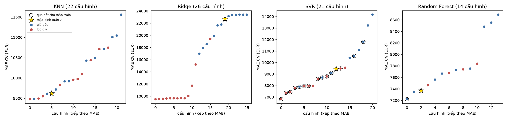
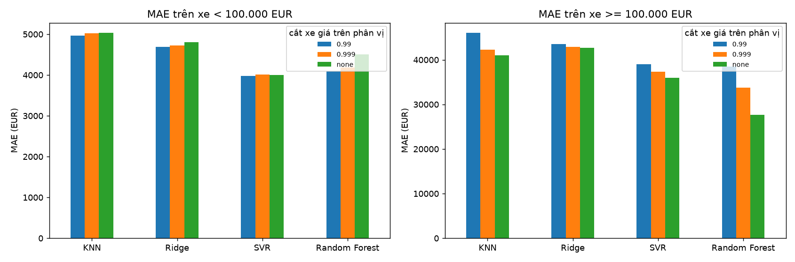
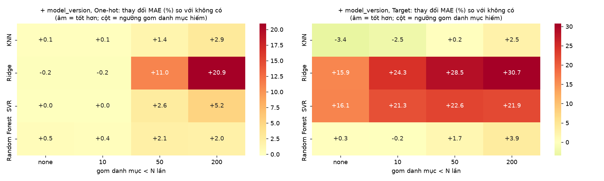
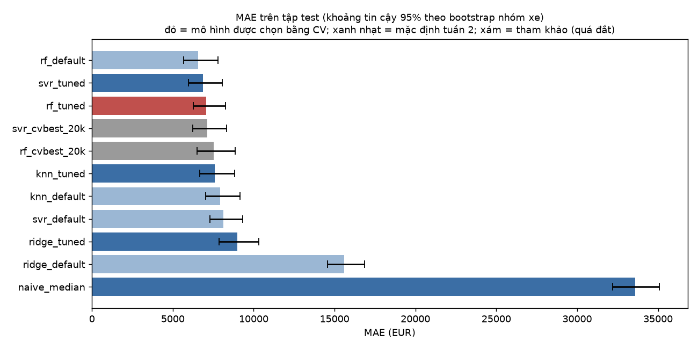
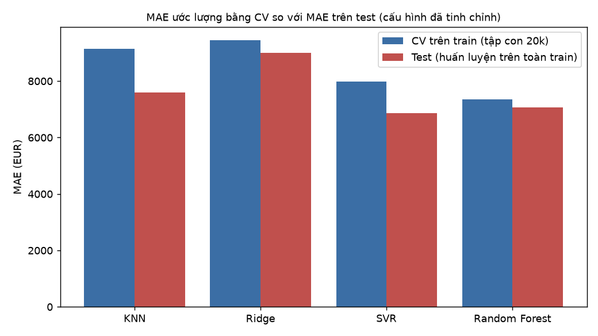
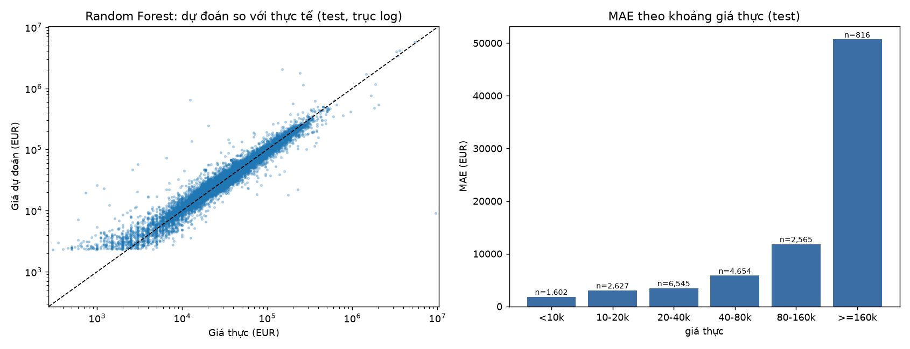
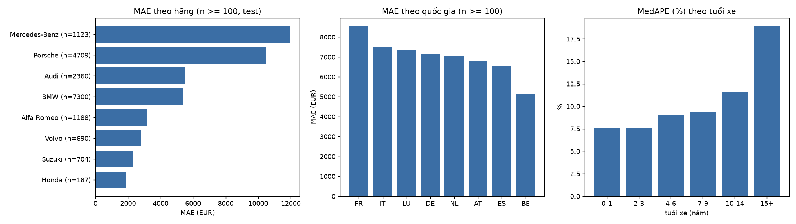

# Báo cáo Tuần 3 – Tinh chỉnh, chốt cấu hình và đánh giá cuối trên tập test

_Mọi số liệu được tính từ `reports/tables/week3_*.csv`, `reports/week3_frozen_config.json` và dự đoán đã lưu của lần đánh giá test duy nhất. Báo cáo sinh bằng `python -m src.reporting_week3`._

> **Lưu ý:** có phát biểu ở Phụ lục A không đúng với dữ liệu; đó là kết quả thật và được nêu trong phần thảo luận.

## 1. Mục tiêu, phạm vi và quy tắc bảo vệ tập test

Tuần 3 (1) tinh chỉnh siêu tham số của bốn mô hình, (2) quyết định hai việc còn treo từ tuần 2: xử lý xe giá cực cao và gom danh mục hiếm của `model_version`, (3) **chốt cấu hình**, rồi (4) đánh giá **đúng một lần** trên tập test và phân tích phần dư.

**Quy trình chống rò rỉ (được cưỡng chế bằng code và test):**

1. Mọi lựa chọn (siêu tham số, log giá, cắt xe giá cao, gom danh mục, mô hình được chọn) chỉ dựa trên **cross-validation trên tập train** (GroupKFold 5 fold theo nhóm xe, cùng tập con 20,001 dòng và cùng các fold như tuần 2).
2. Cấu hình được **ghi băng** vào `reports/week3_frozen_config.json` cùng mã băm của file train và file kết quả. `src/final_eval.py` kiểm tra lại các mã băm này; nếu bất kỳ thứ gì đổi sau khi đóng băng thì từ chối chạy.
3. `final_eval.py` là mô-đun **duy nhất** đọc `test.parquet`. Sau khi chạy xong nó ghi file đánh dấu (`week3_test_evaluation_done.json`); lần chạy thứ hai bị từ chối. Mọi phân tích tiếp theo dùng dự đoán đã lưu.
4. Mọi ngưỡng học từ dữ liệu (ngưỡng cắt giá, ngưỡng gom danh mục, thống kê điền thiếu, scaler, encoder) được tính trên phần train của từng fold (khi CV) hoặc trên toàn bộ train (khi huấn luyện lần cuối), không bao giờ từ dữ liệu đánh giá.

## 2. Thiết kế

**Tiền xử lý cố định** theo kết quả tuần 2 (encoder và scaler của cấu hình tốt nhất từng mô hình): KNN One-hot + Standard, Ridge One-hot + MinMax, SVR One-hot + Standard, Random Forest One-hot (+ Standard). Thêm một yếu tố được tìm kiếm cùng siêu tham số: **dùng log giá hay giá gốc** (`log1p` trên target, đổi ngược bằng `expm1`).

| mô hình | không gian tìm kiếm | số ứng viên |
|---|---|---|
| KNN | n_neighbors ∈ {3, 5, 7, 10, 15, 20, 30, 50}; weights ∈ {uniform, distance}; p ∈ {1, 2} | 22 |
| Ridge | alpha ∈ {0.001, 0.00316228, 0.01, 0.0316228, 0.1, 0.316228, 1, 3.16228, 10, 31.6228, 100, 316.228, 1000} | 26 |
| SVR | C ∈ {1, 3, 10, 30, 100, 300}; epsilon ∈ {0.02, 0.05, 0.1, 0.2}; gamma ∈ {0.012, 0.024, scale, 0.1, 0.2} | 21 |
| Random Forest | n_estimators ∈ {100, 200}; max_depth ∈ {None, 15, 30}; min_samples_leaf ∈ {1, 2, 3, 5}; max_features ∈ {0.3, 0.5, 1} | 14 |

Mỗi mô hình luôn gồm cấu hình mặc định của tuần 2 (với giá gốc và với log giá) làm mốc so sánh. KNN, SVR và Random Forest dùng tìm kiếm ngẫu nhiên có seed (KNN 20, SVR 20, Random Forest 12 ứng viên, không lặp), Ridge duyệt toàn bộ lưới α (không tính mặc định).

**Bốn giai đoạn**, mỗi giai đoạn dùng kết quả của giai đoạn trước:

1. **tune:** siêu tham số + log giá.
2. **extremes:** cắt khỏi tập *huấn luyện* các xe có giá vượt phân vị 99.9%, 99% của chính fold huấn luyện (các dòng đánh giá không bao giờ bị cắt); báo cáo thêm MAE riêng cho xe dưới và từ 100,000 EUR.
3. **grouping:** thêm `model_version`, gom danh mục xuất hiện ít hơn N lần (N ∈ {không gom, 10, 50, 200}) vào một nhãn chung (đếm trên fold huấn luyện), với One-hot và Target Encoding.
4. **combine:** tổ hợp các thành phần thắng ở trên, so với cấu hình tune tốt nhất.

**Quy tắc quyết định (cho mọi thành phần tùy chọn):** ứng viên chỉ thay thế cấu hình đơn giản hơn khi MAE trung bình thấp hơn **và** thắng ít nhất 4/5 fold so với cấu hình đó (tránh chạy theo nhiễu). Với siêu tham số thì chọn MAE trung bình thấp nhất trong các ứng viên đã thử; cách chọn "tốt nhất trong nhiều ứng viên" có thể hơi lạc quan, nên ước lượng cuối cùng dựa vào tập test chưa từng dùng để chọn. Mô hình được chọn là mô hình có MAE CV thấp nhất.

**Ràng buộc chi phí tính toán.** Thời gian huấn luyện đo trong CV (trên khoảng 16.000 dòng) được ngoại suy lên toàn bộ train (75,457 dòng) với hệ số mũ theo mô hình (SVR ≈ bình phương số dòng, Random Forest ≈ 1,2, KNN và Ridge ≈ tuyến tính). Cấu hình có thời gian huấn luyện ước tính trên toàn train vượt **30 phút** không đủ điều kiện được chọn (vì không thể huấn luyện lại để đánh giá cuối). 1 cấu hình SVR cực đoan (C=300, ε=0,02, log giá) bị hủy sau hơn một giờ chưa xong một fold (`reports/tables/week3_skipped_configs.json`). Các cấu hình tốt nhất theo CV nhưng quá đắt được đóng băng làm **mốc tham khảo**: huấn luyện trên cùng tập con 20k dòng như khi CV và đánh giá một lần trên test, không đủ điều kiện được chọn.

## 3. Tinh chỉnh siêu tham số (CV trên train)

**Cấu hình khả thi tốt nhất (đủ điều kiện được chọn) so với mặc định:**

| mô hình | số cấu hình | MAE mặc định | MAE tinh chỉnh | thay đổi % | fold tốt hơn | log giá | siêu tham số tốt nhất |
|---|---|---|---|---|---|---|---|
| KNN | 22 | 9,621.97 | 9,477.84 | -1.50 | 3 / 5 | có | {"n_neighbors": 10, "p": 1, "weights": "distance"} |
| Ridge | 26 | 22,681.17 | 9,499.54 | -58.12 | 5 / 5 | có | {"alpha": 3.1622776601683795} |
| SVR | 21 | 9,445.45 | 7,976.83 | -15.55 | 5 / 5 | có | {"C": 1.0, "epsilon": 0.1, "gamma": 0.012} |
| Random Forest | 14 | 7,369.14 | 7,351.23 | -0.24 | 2 / 5 | không | {"max_depth": 15, "max_features": 0.5, "min_samples_leaf": 1, "n_estimators": 200} |

**Cấu hình tốt nhất theo MAE CV nếu không xét chi phí** (dùng làm mốc tham khảo ở mục 7 khi khác cấu hình trên):

| mô hình | số cấu hình quá đắt | MAE tốt nhất không xét chi phí | thời gian huấn luyện ước tính trên toàn train (giờ) | log giá | siêu tham số |
|---|---|---|---|---|---|
| KNN | 0 | 9,477.84 | 0 | có | {"n_neighbors": 10, "p": 1, "weights": "distance"} |
| Ridge | 0 | 9,499.54 | 0 | có | {"alpha": 3.1622776601683795} |
| SVR | 14 | 6,817.73 | 11.79 | có | {"C": 100.0, "epsilon": 0.05, "gamma": 0.012} |
| Random Forest | 1 | 7,221.43 | 0.91 | không | {"max_depth": null, "max_features": 1.0, "min_samples_leaf": 1, "n_estimators": 200} |

Các chỉ số còn lại (cùng CV):

| mô hình | RMSE mặc định | RMSE tinh chỉnh | R² mặc định | R² tinh chỉnh | MedAPE % mặc định | MedAPE % tinh chỉnh |
|---|---|---|---|---|---|---|
| KNN | 59,461.10 | 69,952.65 | 0.60 | 0.50 | 11.63 | 11.13 |
| Ridge | 79,087.72 | 72,394.18 | 0.31 | 0.47 | 35.63 | 10.67 |
| SVR | 61,838.15 | 66,792.97 | 0.59 | 0.54 | 13.39 | 8.93 |
| Random Forest | 44,435.56 | 41,839.04 | 0.76 | 0.77 | 8.84 | 9.60 |

Mỗi điểm là một cấu hình (xếp theo MAE); ngôi sao là cấu hình mặc định của tuần 2.

## 4. Xe giá cực cao (cắt khỏi tập huấn luyện)

Ngưỡng cắt là phân vị giá của chính fold huấn luyện; mọi dòng đánh giá được giữ nguyên. "Sai số có dấu" = dự đoán − thực tế (âm = dự đoán thấp).

| model | cắt trên phân vị | MAE | MAE < 100k | MAE >= 100k | sai số có dấu >= 100k | RMSE | fold tốt hơn không cắt | Δ MAE % |
|---|---|---|---|---|---|---|---|---|
| KNN | none | 9,477.84 | 5,029.42 | 40,972.66 | -30,226.36 | 69,952.65 |  | 0 |
| KNN | 0.999 | 9,629.86 | 5,020.64 | 42,254.10 | -31,864.67 | 76,514.35 | 2 / 5 | 1.60 |
| KNN | 0.99 | 10,043.68 | 4,965.28 | 46,005.43 | -38,847 | 77,868.20 | 0 / 5 | 5.97 |
| Ridge | none | 9,499.54 | 4,799.88 | 42,737.24 | -17,197.01 | 72,394.18 |  | 0 |
| Ridge | 0.999 | 9,456.46 | 4,729.62 | 42,888.74 | -19,407.66 | 74,439.77 | 4 / 5 | -0.45 |
| Ridge | 0.99 | 9,502.19 | 4,687.28 | 43,580.40 | -22,296.59 | 74,961.34 | 3 / 5 | 0.03 |
| SVR | none | 7,976.83 | 4,004.44 | 36,011.43 | -25,602.34 | 66,792.97 |  | 0 |
| SVR | 0.999 | 8,147.54 | 4,006.54 | 37,376.88 | -27,583.66 | 73,654.50 | 0 / 5 | 2.14 |
| SVR | 0.99 | 8,330.57 | 3,982.64 | 39,034.85 | -31,585.71 | 75,343.49 | 0 / 5 | 4.43 |
| Random Forest | none | 7,351.23 | 4,505.21 | 27,707.11 | -13,123.93 | 41,839.04 |  | 0 |
| Random Forest | 0.999 | 7,866.64 | 4,184.93 | 33,761.59 | -22,248.23 | 73,301.12 | 2 / 5 | 7.01 |
| Random Forest | 0.99 | 8,353.53 | 4,087.38 | 38,448.31 | -31,131.08 | 76,648.68 | 0 / 5 | 13.63 |

Các lựa chọn được chấp nhận theo quy tắc ở mục 2 sẽ được ghi ở mục 6.

## 5. `model_version` và gom danh mục hiếm

Cấu hình cơ sở là cấu hình tune tốt nhất của từng mô hình (không có `model_version`). Δ MAE < 0 là có `model_version` tốt hơn.

| model | encoder | gom < N lần | MAE | MAE không có model_version | Δ MAE % | số cột | fold tốt hơn không có |
|---|---|---|---|---|---|---|---|
| KNN | One-hot | none | 9,487.07 | 9,477.84 | 0.10 | 314 | 1 / 5 |
| KNN | One-hot | 10 | 9,487.07 | 9,477.84 | 0.10 | 314 | 1 / 5 |
| KNN | One-hot | 50 | 9,612.54 | 9,477.84 | 1.42 | 139 | 0 / 5 |
| KNN | One-hot | 200 | 9,748.78 | 9,477.84 | 2.86 | 87 | 0 / 5 |
| KNN | Target | none | 9,153.89 | 9,477.84 | -3.42 | 22 | 5 / 5 |
| KNN | Target | 10 | 9,237.28 | 9,477.84 | -2.54 | 22 | 5 / 5 |
| KNN | Target | 50 | 9,496.51 | 9,477.84 | 0.20 | 22 | 1 / 5 |
| KNN | Target | 200 | 9,715.86 | 9,477.84 | 2.51 | 22 | 0 / 5 |
| Ridge | One-hot | none | 9,483.23 | 9,499.54 | -0.17 | 314 | 4 / 5 |
| Ridge | One-hot | 10 | 9,483.24 | 9,499.54 | -0.17 | 314 | 4 / 5 |
| Ridge | One-hot | 50 | 10,543.60 | 9,499.54 | 10.99 | 139 | 0 / 5 |
| Ridge | One-hot | 200 | 11,488.01 | 9,499.54 | 20.93 | 87 | 0 / 5 |
| Ridge | Target | none | 11,009.64 | 9,499.54 | 15.90 | 22 | 1 / 5 |
| Ridge | Target | 10 | 11,810.29 | 9,499.54 | 24.32 | 22 | 0 / 5 |
| Ridge | Target | 50 | 12,211.08 | 9,499.54 | 28.54 | 22 | 0 / 5 |
| Ridge | Target | 200 | 12,418.42 | 9,499.54 | 30.73 | 22 | 0 / 5 |
| SVR | One-hot | none | 7,980 | 7,976.83 | 0.04 | 314 | 1 / 5 |
| SVR | One-hot | 10 | 7,980 | 7,976.83 | 0.04 | 314 | 1 / 5 |
| SVR | One-hot | 50 | 8,181.04 | 7,976.83 | 2.56 | 139 | 0 / 5 |
| SVR | One-hot | 200 | 8,389.64 | 7,976.83 | 5.18 | 87 | 0 / 5 |
| SVR | Target | none | 9,263.70 | 7,976.83 | 16.13 | 22 | 0 / 5 |
| SVR | Target | 10 | 9,673.66 | 7,976.83 | 21.27 | 22 | 0 / 5 |
| SVR | Target | 50 | 9,777.44 | 7,976.83 | 22.57 | 22 | 0 / 5 |
| SVR | Target | 200 | 9,723.70 | 7,976.83 | 21.90 | 22 | 0 / 5 |
| Random Forest | One-hot | none | 7,390.19 | 7,351.23 | 0.53 | 314 | 1 / 5 |
| Random Forest | One-hot | 10 | 7,378.81 | 7,351.23 | 0.38 | 314 | 2 / 5 |
| Random Forest | One-hot | 50 | 7,505.81 | 7,351.23 | 2.10 | 139 | 1 / 5 |
| Random Forest | One-hot | 200 | 7,495.09 | 7,351.23 | 1.96 | 87 | 1 / 5 |
| Random Forest | Target | none | 7,373.94 | 7,351.23 | 0.31 | 22 | 4 / 5 |
| Random Forest | Target | 10 | 7,339.94 | 7,351.23 | -0.15 | 22 | 2 / 5 |
| Random Forest | Target | 50 | 7,475.22 | 7,351.23 | 1.69 | 22 | 0 / 5 |
| Random Forest | Target | 200 | 7,636.59 | 7,351.23 | 3.88 | 22 | 0 / 5 |

## 6. Cấu hình đóng băng

| mô hình | cấu hình đóng băng | siêu tham số | MAE CV | MAE CV mặc định | R² CV | tổ hợp thành phần tùy chọn |
|---|---|---|---|---|---|---|
| KNN | Target, Standard, log giá, + model_version | {"n_neighbors": 10, "p": 1, "weights": "distance"} | 9,153.89 | 9,621.97 | 0.58 | có |
| Ridge | One-hot, MinMax, log giá, cắt xe giá > phân vị 99.9% của train, + model_version | {"alpha": 3.1622776601683795} | 9,440.87 | 22,681.17 | 0.44 | có |
| SVR | One-hot, Standard, log giá | {"C": 1.0, "epsilon": 0.1, "gamma": 0.012} | 7,976.83 | 9,445.45 | 0.54 | không |
| Random Forest | One-hot, Standard, giá gốc | {"max_depth": 15, "max_features": 0.5, "min_samples_leaf": 1, "n_estimators": 200} | 7,351.23 | 7,369.14 | 0.77 | không |

**Mô hình được chọn bằng CV: Random Forest.** Cấu hình được ghi lúc 2026-11-05T22:56:02 (`reports/week3_frozen_config.json`).

## 7. Đánh giá cuối trên tập test (một lần duy nhất)

Mỗi mô hình được huấn luyện lại trên **toàn bộ train** (75,457 dòng) với cấu hình đóng băng rồi dự đoán 18,809 xe của tập test (nhóm xe không giao với train). Khoảng tin cậy 95% lấy bằng **bootstrap theo nhóm xe** (1,000 lần lấy mẫu lại cả nhóm vì các tin cùng một xe không độc lập).

| mô hình | MAE | MAE 95% CI | RMSE | R² | R² 95% CI | MedAPE % | fit (s) |
|---|---|---|---|---|---|---|---|
| Random Forest (mặc định tuần 2) | 6,557.12 | 5,666 – 7,805 | 78,601.25 | 0.47 | 0.17 – 0.90 | 7.52 | 1,141.65 |
| SVR (đã tinh chỉnh) | 6,862.30 | 5,951 – 8,074 | 78,399.15 | 0.47 | 0.20 – 0.90 | 8.01 | 516.54 |
| Random Forest (đã tinh chỉnh) ◀ được chọn | 7,060.59 | 6,257 – 8,270 | 75,391.18 | 0.51 | 0.21 – 0.93 | 9.25 | 385.01 |
| SVR (tốt nhất theo CV nhưng quá đắt; huấn luyện trên 20k dòng) [tham khảo] | 7,137.89 | 6,234 – 8,331 | 78,092.41 | 0.47 | 0.20 – 0.87 | 8.17 | 1,542.62 |
| Random Forest (tốt nhất theo CV nhưng quá đắt; huấn luyện trên 20k dòng) [tham khảo] | 7,526.30 | 6,493 – 8,858 | 82,183.93 | 0.42 | 0.15 – 0.85 | 8.36 | 321.03 |
| KNN (đã tinh chỉnh) | 7,587.35 | 6,661 – 8,822 | 79,334.82 | 0.46 | 0.19 – 0.89 | 9.01 | 16.71 |
| KNN (mặc định tuần 2) | 7,928.04 | 7,034 – 9,161 | 77,017.89 | 0.49 | 0.21 – 0.91 | 9.59 | 47.03 |
| SVR (mặc định tuần 2) | 8,123.19 | 7,300 – 9,313 | 75,838.41 | 0.50 | 0.21 – 0.93 | 12.26 | 4,623.65 |
| Ridge (đã tinh chỉnh) | 8,996.90 | 7,844 – 10,314 | 91,725.29 | 0.28 | 0.14 – 0.64 | 10 | 2.13 |
| Ridge (mặc định tuần 2) | 15,588.79 | 14,569 – 16,846 | 86,426.60 | 0.36 | 0.09 – 0.78 | 23.94 | 1.80 |
| Mô hình ngây thơ (trung vị giá train) | 33,580.97 | 32,193 – 35,070 | 109,481.61 | -0.03 | -0.08 – -0.02 | 50.66 | 0 |

**So sánh cặp (bootstrap theo nhóm):**

| so sánh (MAE của B − A) | 95% CI của hiệu | xác suất B tốt hơn A |
|---|---|---|
| knn_tuned - knn_default | -523 – -152 | 100.0% |
| ridge_tuned - ridge_default | -7,324 – -5,884 | 100.0% |
| svr_tuned - svr_default | -1,448 – -1,057 | 100.0% |
| rf_tuned - rf_default | 323 – 667 | 0.0% |
| rf_tuned - knn_tuned | -1,044 – -70 | 98.4% |
| rf_tuned - ridge_tuned | -2,665 – -1,214 | 100.0% |
| rf_tuned - svr_tuned | -268 – 631 | 18.3% |

**MAE ước lượng bằng CV so với MAE trên test (cấu hình đã tinh chỉnh):**

| mô hình | MAE CV (train, 20k) | MAE test | chênh lệch % |
|---|---|---|---|
| KNN | 9,153.89 | 7,587.35 | -17.11 |
| Ridge | 9,440.87 | 8,996.90 | -4.70 |
| SVR | 7,976.83 | 6,862.30 | -13.97 |
| Random Forest | 7,351.23 | 7,060.59 | -3.95 |

Lưu ý: ước lượng CV dùng tập con 20k dòng và các mô hình nhỏ hơn; mô hình cuối được huấn luyện trên 75,457 dòng nên khác biệt là bình thường.

## 8. Phân tích phần dư của mô hình được chọn (Random Forest, test)

"Sai số có dấu" = dự đoán − thực tế (âm = dự đoán thấp hơn giá thực).

**Theo khoảng giá thực:**

| khoảng giá | n | MAE | sai số có dấu | MedAPE % | giá trung vị |
|---|---|---|---|---|---|
| <10k | 1,602 | 1,854.96 | 1,123.43 | 24.39 | 5,700 |
| 10-20k | 2,627 | 3,051.82 | 1,961.01 | 12.36 | 16,900 |
| 20-40k | 6,545 | 3,490.39 | 836.47 | 8.99 | 28,900 |
| 40-80k | 4,654 | 5,852.61 | 517.35 | 7.74 | 57,950 |
| 80-160k | 2,565 | 11,839.01 | -349.26 | 7.51 | 106,890 |
| >=160k | 816 | 50,691.36 | -23,652.56 | 7.70 | 204,754 |

**Theo tuổi xe:**

| tuổi (năm) | n | MAE | sai số có dấu | MedAPE % | giá trung vị |
|---|---|---|---|---|---|
| 0-1 | 3,447 | 11,276.58 | -294.31 | 7.60 | 76,500 |
| 2-3 | 2,566 | 7,515 | 263.21 | 7.57 | 49,407 |
| 4-6 | 5,806 | 5,256.39 | 32.24 | 9.09 | 31,395 |
| 7-9 | 3,127 | 4,287.66 | 226.14 | 9.36 | 27,400 |
| 10-14 | 2,104 | 9,148.68 | -4,140.70 | 11.58 | 21,495 |
| 15+ | 1,752 | 6,457.64 | 1,677.07 | 18.89 | 9,000 |

**Theo quốc gia (n ≥ 100):**

| quốc gia | n | MAE | sai số có dấu | MedAPE % | giá trung vị |
|---|---|---|---|---|---|
| FR | 1,255 | 8,535.56 | -934.97 | 8.96 | 49,900 |
| IT | 4,203 | 7,505.29 | -2,125.12 | 8.62 | 31,000 |
| LU | 133 | 7,372.95 | 954.95 | 8.20 | 63,990 |
| DE | 6,455 | 7,128.93 | 1,875.41 | 9.45 | 34,799 |
| NL | 2,529 | 7,043.94 | -1,458.02 | 9.90 | 33,940 |
| AT | 1,241 | 6,796.08 | -3,615.93 | 9.15 | 39,157 |
| ES | 1,331 | 6,558.55 | -508.44 | 10.49 | 32,600 |
| BE | 1,660 | 5,155.18 | 827.80 | 8.72 | 33,000 |

**Theo hãng (n ≥ 100, sắp theo MAE giảm dần):**

| hãng | n | MAE | sai số có dấu | MedAPE % | giá trung vị |
|---|---|---|---|---|---|
| Mercedes-Benz | 1,123 | 11,954.99 | -1,502.57 | 9.20 | 66,945 |
| Porsche | 4,709 | 10,461.45 | 409.33 | 7.33 | 75,500 |
| Audi | 2,360 | 5,523.78 | 358.45 | 8.09 | 39,997 |
| BMW | 7,300 | 5,345.09 | -1,307.69 | 10.06 | 27,500 |
| Alfa Romeo | 1,188 | 3,185.92 | 540.03 | 10.47 | 24,425 |
| Volvo | 690 | 2,806.12 | 505.62 | 13.79 | 17,470 |
| Suzuki | 704 | 2,292.99 | 994.37 | 11.94 | 14,994 |
| Honda | 187 | 1,861.31 | -645.10 | 13.25 | 10,995 |

**10 dự đoán sai nhiều nhất:**

| brand | model | production_year | mileage_km | country_code | price | pred | err |
|---|---|---|---|---|---|---|---|
| BMW | 316 | 2,015 | 200,000 | IT | 9,500,000 | 9,157.90 | -9,490,842.10 |
| Porsche | 911 | 2,006 | 168,950 | DE | 149,911 | 2,036,130.80 | 1,886,219.80 |
| Porsche | Taycan | 2,025 | 115 | DE | 241,800 | 1,764,996.89 | 1,523,196.89 |
| Porsche |  | 2,019 | 53 | DE | 2,025,000 | 543,669.34 | -1,481,330.66 |
| Mercedes-Benz | G 63 AMG | 2,025 | 93 | DE | 1,814,750 | 479,385.32 | -1,335,364.68 |
| Porsche | Carrera GT | 2,004 | 10,504 | NL | 1,649,950 | 757,349.31 | -892,600.69 |
| Porsche |  | 2,021 | 21,404 | NL | 264,950 | 1,147,188.06 | 882,238.06 |
| Aston Martin | Valkyrie | 2,022 | 769 | NL | 3,300,000 | 3,995,590.67 | 695,590.67 |
| Aston Martin |  | 2,024 | 55 | DE | 1,849,007 | 1,173,145.16 | -675,861.84 |
| Bugatti |  | 1,967 | 60,000 | NL | 12,345 | 646,013.68 | 633,668.68 |

**Độ nhạy với các nhãn lỗi (mô tả sau khi đánh giá, không dùng để chọn lại mô hình).** Cột "bỏ dòng nghi lỗi" loại các tin bị gắn cờ giá nghi lỗi ở tuần 1 (`flag_price_review`, 1 tin trong test); "SSE top 5" là phần trăm tổng sai số bình phương do 5 dự đoán sai nhất gây ra.

| mô hình | MAE | MAE bỏ dòng nghi lỗi | RMSE | RMSE bỏ dòng nghi lỗi | R² | R² bỏ dòng nghi lỗi | SSE top 5 (%) |
|---|---|---|---|---|---|---|---|
| rf_default | 6,557.12 | 6,052.89 | 78,601.25 | 37,281.27 | 0.47 | 0.80 | 92.25 |
| svr_tuned | 6,862.30 | 6,358.05 | 78,399.15 | 36,845.76 | 0.47 | 0.80 | 91.68 |
| rf_tuned | 7,060.59 | 6,556.35 | 75,391.18 | 29,914.71 | 0.51 | 0.87 | 93.48 |
| svr_cvbest_20k | 7,137.89 | 6,633.65 | 78,092.41 | 36,185.22 | 0.47 | 0.81 | 89.07 |
| rf_cvbest_20k | 7,526.30 | 7,022.06 | 82,183.93 | 44,327.19 | 0.42 | 0.71 | 88.63 |
| knn_tuned | 7,587.35 | 7,083.08 | 79,334.82 | 38,782.53 | 0.46 | 0.78 | 90.68 |
| knn_default | 7,928.04 | 7,423.86 | 77,017.89 | 33,809.93 | 0.49 | 0.83 | 92.39 |
| svr_default | 8,123.19 | 7,618.95 | 75,838.41 | 31,007.17 | 0.50 | 0.86 | 94.30 |
| ridge_tuned | 8,996.90 | 8,492.69 | 91,725.29 | 60,194.59 | 0.28 | 0.47 | 88.47 |
| ridge_default | 15,588.79 | 15,085.17 | 86,426.60 | 51,806.65 | 0.36 | 0.61 | 84.12 |
| naive_median | 33,580.97 | 33,079.48 | 109,481.61 | 84,989.12 | -0.03 | -0.05 | 68.09 |

## 9. Thảo luận

1. **Tinh chỉnh có đáng không?** Mức thay đổi MAE CV so với mặc định: KNN -1.5%, Ridge -58.1%, SVR -15.5%, Random Forest -0.2%. Mức cải thiện lớn nhất thuộc về mô hình bị thiệt nhất do siêu tham số mặc định (Ridge/SVR thường hưởng lợi từ log giá và α/C phù hợp), trong khi Random Forest ít nhạy.
2. **Xe giá cực cao:** cắt chúng khỏi tập huấn luyện làm sai số trên xe từ 100,000 EUR tăng ở 8/8 cặp (mô hình, mức cắt); lựa chọn nào được nhận theo quy tắc 4/5 fold được ghi ở mục 6.
3. **model_version:** thay đổi MAE tốt nhất so với không có `model_version` ở từng mô hình: KNN -3.4% (Target, gom none, 5/5 fold), Ridge -0.2% (One-hot, gom none, 4/5 fold), SVR +0.0% (One-hot, gom none, 1/5 fold), Random Forest -0.2% (Target, gom 10, 2/5 fold). Với One-hot, `model_version` (đã gom danh mục < 10 lần) thay đổi MAE nhiều nhất 0.5%, phù hợp với kết luận tuần 2; gom mạnh hơn (≥ 50 lần) hầu như luôn làm tệ hơn (100% số cấu hình). Chỉ KNN hưởng lợi rõ ràng (Target Encoding); Target Encoding làm tệ Ridge và SVR.
4. **Mô hình được chọn bằng CV:** Random Forest (MAE test 7,061 EUR, R² 0.51, MedAPE 9.3%). Mô hình ngây thơ (luôn đoán trung vị) có MAE 33,581 EUR, nên mọi mô hình đã tinh chỉnh giảm sai số hơn 70%.
5. **CV và test không hoàn toàn đồng ý.** Thứ hạng theo MAE CV: Random Forest < SVR < KNN < Ridge; theo MAE test: SVR < Random Forest < KNN < Ridge. Khác biệt giữa hai mô hình dẫn đầu nằm trong khoảng bất định (xem so sánh cặp ở mục 7), nên không thể khẳng định mô hình nào tốt hơn một cách chắc chắn.
6. **Tinh chỉnh không giúp mô hình được chọn trên test.** Random Forest đã tinh chỉnh có MAE test 7,061 EUR so với 6,557 EUR của cấu hình mặc định (hiệu MAE 95% CI 323 đến 667 EUR). Một giải thích hợp lý (chưa kiểm chứng riêng) là siêu tham số được chọn trên 16.000 dòng huấn luyện (cây nông hơn và ít đặc trưng mỗi lần chia hơn để đủ nhanh) không còn tối ưu khi huấn luyện trên 75.000 dòng, nơi cây sâu hơn có lợi. Ngược lại, tinh chỉnh giúp rõ rệt Ridge (chủ yếu nhờ log giá), SVR và KNN. **Lưu ý:** cấu hình mặc định của Random Forest cho MAE test thấp nhất toàn bộ, nhưng đó là quan sát sau khi đã dùng test; không được dùng nó để chọn lại mô hình (sẽ biến tập test thành tập chọn). Muốn kết luận chắc chắn cần dữ liệu giữ lại mới hoặc CV trên toàn bộ train.
7. **R² thấp là do nhãn lỗi, không phải do mô hình tệ.** R² của Random Forest là 0.51 nhưng chỉ cần bỏ 1 tin bị gắn cờ giá nghi lỗi (BMW 316 giá 9,5 triệu EUR) thì lên 0.87; 5 dự đoán sai nhất gây 93% tổng sai số bình phương. Vì vậy báo cáo dùng MAE/MedAPE làm chỉ số chính.
8. **Xe đắt là điểm yếu.** MedAPE gần như đều ở các nhóm giá từ 10-20k trở lên (7.5% đến 12.4%; nhóm <10k cao hơn: 24.4%), nhưng MAE tuyệt đối tăng theo giá và mô hình dự đoán thấp hơn thực tế khoảng 23,653 EUR với xe từ 160.000 EUR (xe hiếm, ít mẫu huấn luyện).

## 10. Kết luận cho môn học

- **Quy trình:** dữ liệu AutoScout24 (118.382 tin) → 94,266 xe cũ hợp lệ → chia theo nhóm xe → so sánh Encoding × Scaling (tuần 2) → tinh chỉnh và chốt cấu hình bằng CV (tuần 3) → đánh giá test đúng một lần.
- **Kết quả cuối:** mô hình được chọn theo quy trình là Random Forest với MAE test 7,061 EUR (MedAPE 9.3%), so với 33,581 EUR của mô hình ngây thơ. Trên test, SVR đã tinh chỉnh (6,862 EUR) và Random Forest chênh nhau không có ý nghĩa thống kê.
- **Bài học về phương pháp:** (1) tinh chỉnh giúp nhiều nhất mô hình yếu nhất lúc đầu (Ridge giảm khoảng 42% MAE test nhờ log giá và α); (2) siêu tham số tối ưu trên tập con nhỏ có thể không chuyển sang dữ liệu lớn hơn (Random Forest); (3) chỉ số RMSE/R² bị vài nhãn lỗi chi phối nên cần MAE/MedAPE và kiểm tra dữ liệu; (4) chi phí tính toán là một ràng buộc thật khi chọn mô hình (SVR).
- **Điểm yếu cần cải thiện:** xe rất đắt (từ 160.000 EUR) bị dự đoán thấp; nhãn lỗi trong dữ liệu gốc.
- **Hướng phát triển (đồ án tốt nghiệp):** làm sạch nhãn lỗi bằng quy tắc dựa trên giá thị trường, thử mô hình boosting, thu thập dữ liệu thị trường Việt Nam và dùng `vietnam_adapter` để thay AutoScout24, kiểm tra lại các kết luận về encoding/scaling trên dữ liệu mới.

## 11. Giới hạn và rủi ro

- Tinh chỉnh chạy trên tập con 20.000 dòng của train với 5 fold; siêu tham số tối ưu cho 16.000 dòng huấn luyện có thể không tối ưu cho 75.000 dòng (đặc biệt k của KNN, số cây và độ sâu của Random Forest).
- Không gian tìm kiếm có kích thước hữu hạn (tìm kiếm ngẫu nhiên 12–20 ứng viên); chọn "tốt nhất trong nhiều ứng viên" làm MAE CV hơi lạc quan. Tập test cho ước lượng không chệch nhưng chỉ là **một** phép đo trên một lần chia.
- Tập test chung phân phối với train (cùng nguồn, cùng thời điểm snapshot, thiên về xe cao cấp châu Âu): kết quả không suy ra được cho giá xe ở thị trường khác hoặc thời điểm khác, kể cả Việt Nam.
- Giá là giá chào bán, không phải giá giao dịch; không kiểm soát được chất lượng thực tế của xe (tai nạn, bảo dưỡng).
- Phần nhóm xe: tin trùng không có VIN chỉ được nhóm gần đúng (tuần 1); nếu còn tin trùng chéo train/test thì MAE test hơi lạc quan.
- Ridge trên ma trận thưa dùng bộ giải lặp (`tol=1e-4`) nên chạy lại có thể lệch cỡ 1e-4 tương đối; KNN có thể lệch cỡ 1e-6 do thứ tự cộng số thực khi song song.
- Thời gian huấn luyện đo khi nhiều tiến trình chạy song song, chỉ so sánh tương đối.
- Các "giải thích hợp lý" trong báo cáo là giả thuyết, chưa kiểm chứng bằng thí nghiệm riêng.

## Phụ lục A. Tự kiểm chứng các phát biểu

Các phát biểu định tính được máy tính kiểm tra lại với bảng số liệu mỗi lần sinh báo cáo (`verify_claims` trong `src/reporting_week3.py`). Phát biểu "KHÔNG ĐÚNG" không phải lỗi mà là kết quả thật của thí nghiệm, cần được hiểu và nêu trong phần thảo luận.

| mã | phát biểu | kiểm tra với dữ liệu |
|---|---|---|
| W1 | Cấu hình tinh chỉnh không tệ hơn cấu hình mặc định về MAE CV ở mọi mô hình (mặc định là một ứng viên) | ĐÚNG |
| W2 | Mọi mô hình đã tinh chỉnh có MAE test thấp hơn mô hình ngây thơ ít nhất 50% | ĐÚNG |
| W3 | Mô hình được chọn bằng CV cũng có MAE test thấp nhất trong 4 mô hình đã tinh chỉnh | KHÔNG ĐÚNG |
| W4 | MAE test lệch không quá 30% so với MAE CV ở mọi mô hình đã tinh chỉnh | ĐÚNG |
| W5 | Thứ hạng 4 mô hình theo MAE test trùng thứ hạng theo MAE CV | KHÔNG ĐÚNG |
| W6 | Mô hình được chọn tốt hơn từng mô hình tuned khác với xác suất bootstrap ≥ 95% (khoảng tin cậy của hiệu MAE nằm dưới 0) | KHÔNG ĐÚNG |
| W7 | MAE tuyệt đối tăng theo khoảng giá (xe đắt có MAE lớn nhất) nhưng MedAPE của nhóm giá cao không vượt MedAPE của nhóm giá thấp nhất | ĐÚNG |
| W8 | Mô hình được chọn dự đoán thấp hơn giá thực của xe >= 160.000 EUR (sai số có dấu âm) | ĐÚNG |
| W10 | Cấu hình tinh chỉnh của mô hình được chọn KHÔNG tệ hơn cấu hình mặc định trên test (khoảng tin cậy của hiệu MAE không nằm hoàn toàn trên 0) | KHÔNG ĐÚNG |
| W11 | Loại các dòng nhãn nghi lỗi từ tuần 1 làm R² của mô hình được chọn tăng thêm ít nhất 0,2 (R² do vài nhãn lỗi chi phối) | ĐÚNG |
| W12 | 5 dự đoán sai nhất chiếm hơn 80% tổng sai số bình phương của mô hình được chọn | ĐÚNG |
| W9 | Cắt xe giá cao khỏi tập huấn luyện làm tăng MAE trên xe >= 100.000 EUR ở mọi mô hình và mức cắt | ĐÚNG |
